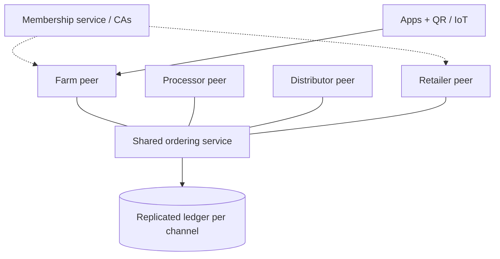

**In simple words:** consortium blockchain ko kai organisations milkar chalati hain, na ek company aur na poori duniya. Har member kuch nodes chalata hai.

**Definition:** consortium (federated) blockchain permissioned hoti hai, aur blocks validate karne ka haq pehle se chune hue organisations ke group mein baanta hota hai. <Cite id="private-blockchain-gfg-consortium" />

**Case study: IBM Food Trust (food supply chain, Hyperledger Fabric pe).**

- **Problem:** retailers, suppliers aur farms ke alag records hain, isliye contaminated food trace karne mein din lag jaate hain.
- **Members:** farms, processors, distributors aur Walmart, Carrefour, Nestle jaise retailers, aur platform operator IBM.
- **Solution:** har handover (harvest, packing, shipping, shelf) shared ledger pe record hota hai. Har member sirf wahi data dekhta hai jiski ijazat hai. Pilot mein Walmart ne mangoes ko unke farm tak 2.2 seconds mein trace kiya, jabki pehle lagbhag 7 din lagte the. <Cite id="hyperledger-fabric-ibm-fabric" />
- **Result:** tez recalls, kam waste, zyada trust.

(Aur examples: banks ke liye R3 Corda, trade finance ke liye we.trade, shipping ke liye TradeLens.)

**Architecture:**

1. Har organisation ek ya zyada peer nodes chalati hai aur uski apni certificate authority hoti hai.
2. Members membership service (MSP) se judte hain, jo identities deti hai.
3. Common ordering service (milkar chalayi jaati hai) transactions ko order karti hai.
4. Channels se members ke subsets private data share karte hain.
5. Chaincode (smart contract) mein business rules hote hain; endorsement ke liye kai organisations ke signatures chahiye. <Cite id="private-blockchain-fabric-network" />
6. Apps aur IoT/barcode scanners APIs se transactions submit karte hain.

<Figure caption="Network ka koi ek malik nahi; har member apna peer chalata hai.">

</Figure>

**Benefits:** bina ek boss ke shared trust, privacy, speed. **Limits:** members ko governance pe agree karna padta hai, aur ye public chain se kam open hai. <Cite id="blockchain-applications-gfg-supply-revolution" />

**Conclusion:** consortium chain unn businesses ke liye hai jinhe cooperate karna hai par jo ek dusre pe poora bharosa nahi karte.
