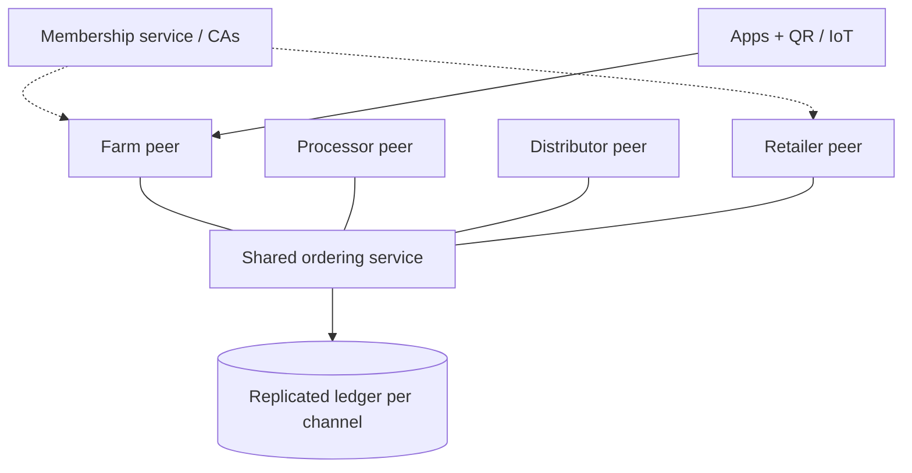

**In simple words:** a consortium blockchain is run by a group of organisations together, not by one company and not by the whole world. Each member runs some of the nodes.

**Definition:** a consortium (federated) blockchain is permissioned, and the right to validate blocks is shared among a pre-selected group of organisations. <Cite id="private-blockchain-gfg-consortium" />

**Case study: IBM Food Trust (food supply chain, on Hyperledger Fabric).**

- **Problem:** retailers, suppliers and farms keep separate records, so tracing a contaminated food takes days.
- **Members:** farms, processors, distributors and retailers such as Walmart, Carrefour and Nestle, plus IBM as the platform operator.
- **Solution:** every handover (harvest, packing, shipping, shelf) is recorded on a shared ledger. Each member sees only the data it is allowed to see. Walmart traced mangoes to their farm in 2.2 seconds in a pilot, versus nearly 7 days earlier. <Cite id="hyperledger-fabric-ibm-fabric" />
- **Result:** faster recalls, less waste, more trust.

(Other examples: R3 Corda for banks, we.trade for trade finance, TradeLens for shipping.)

**Architecture:**

1. Each organisation runs one or more peer nodes and has its own certificate authority.
2. Members join through a membership service (MSP), which gives identities.
3. A common ordering service (run jointly) orders transactions.
4. Channels let subsets of members share private data.
5. Chaincode (smart contract) holds the business rules; endorsement needs signatures from several organisations. <Cite id="private-blockchain-fabric-network" />
6. Apps and IoT/barcode scanners submit transactions through APIs.

<Figure caption="No single organisation owns the network; every member runs its own peer.">

</Figure>

**Benefits:** shared trust without one boss, privacy, speed. **Limits:** members must agree on governance, and it is less open than a public chain. <Cite id="blockchain-applications-gfg-supply-revolution" />

**Conclusion:** a consortium chain suits businesses that must cooperate but do not fully trust one another.
