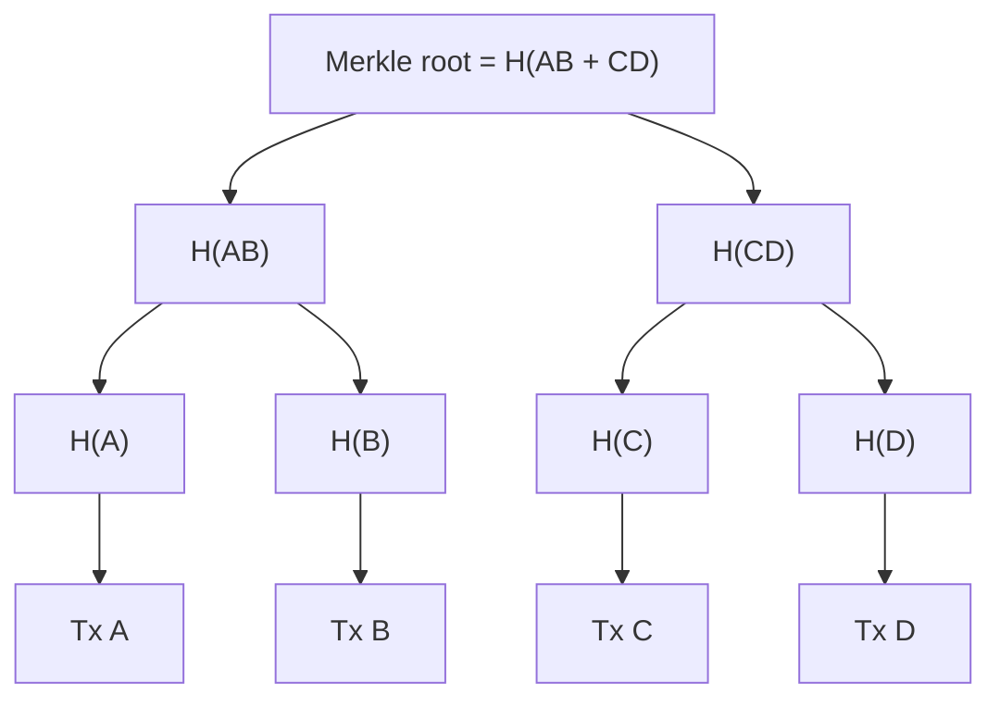

**In simple words:** Merkle tree fingerprints ka tree hai. Isse hazaron transactions ko ek hash mein summarise kar sakte hain, aur bina baaki sab dikhaye prove kar sakte hain ki ek transaction andar hai.

**Definition:** Merkle (hash) tree ek binary tree hai jisme har leaf ek data block (transaction) ka hash hai aur har parent apne do children ko jodkar unka hash hai. Sabse upar **Merkle root** hota hai. <Cite id="block-structure-merkle-wiki-merkle" />

**Kaise banta hai:**

1. Har transaction ka hash: H(A), H(B), H(C), H(D).
2. Pairs jodkar phir hash: H(AB) = hash(H(A) + H(B)), H(CD) = hash(H(C) + H(D)).
3. Unhe jodo: Merkle root = hash(H(AB) + H(CD)).
4. Agar kisi level pe nodes ki sankhya odd hai, to aakhri hash duplicate hota hai (Bitcoin aisa karta hai). <Cite id="block-structure-merkle-mb-ch11" />

<Figure caption="Chaar transactions ek root mein simat gaye, jo block header mein store hota hai.">

</Figure>

**Merkle proof (verification):** Tx C block mein hai ye prove karne ke liye H(D) aur H(AB) do. Verifier H(C) nikalta hai, phir H(C) aur H(D) se H(CD), phir H(AB) aur H(CD) se root, aur header ke root se compare karta hai. Sirf log2(n) hashes chahiye, saare n nahi. Light (SPV) wallets yahi use karte hain. <Cite id="blockchain-fundamentals-nakamoto" loc="§8" />

**Properties:**

- **Tamper detection:** ek transaction badlo to uska leaf, uske saare parents aur root badal jaate hain.
- **Efficient:** 1000 transactions ke block ke liye proof mein lagbhag 10 hashes.
- **Chhota header:** ek 32-byte root poore block ko represent karta hai.

**Uses:** Bitcoin aur Ethereum (Ethereum state ke liye Merkle Patricia trie use karta hai), Git, IPFS, Cassandra. <Cite id="block-structure-merkle-gfg-merkle" /> <Cite id="block-structure-merkle-lmab-merkle" />

**Conclusion:** Merkle tree sasta, tamper-evident proof deta hai ki transaction block ka hissa hai.
