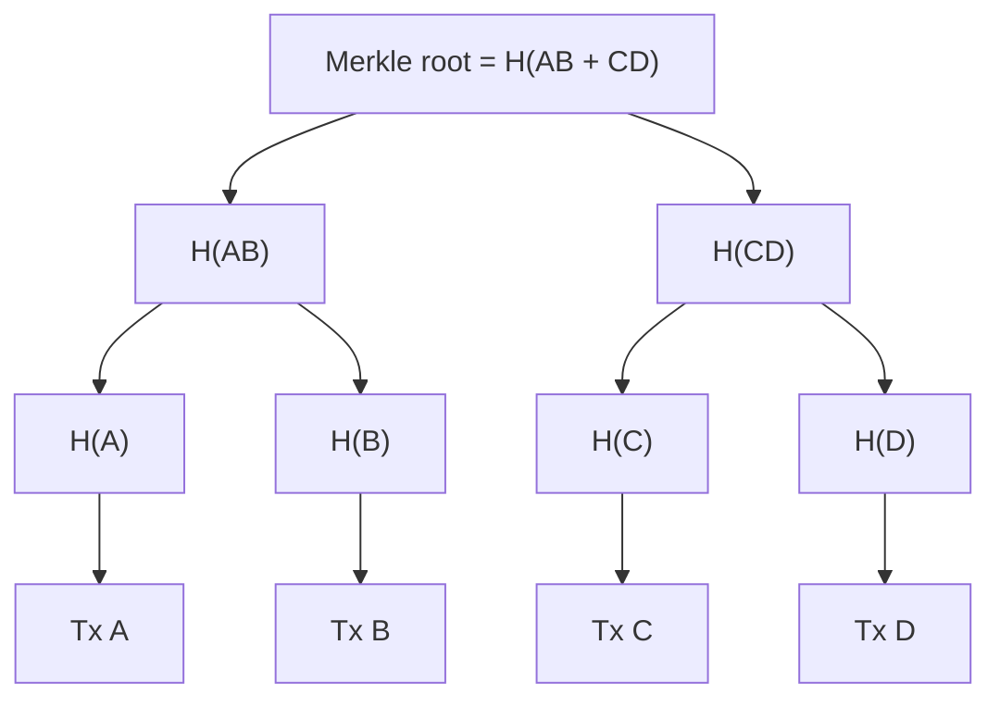

**In simple words:** a Merkle tree is a tree of fingerprints. It lets you summarise thousands of transactions with a single hash and prove that one transaction is inside, without showing all the rest.

**Definition:** a Merkle (hash) tree is a binary tree in which each leaf is the hash of a data block (a transaction) and each parent is the hash of its two children joined together. The top is the **Merkle root**. <Cite id="block-structure-merkle-wiki-merkle" />

**How it is built:**

1. Hash each transaction: H(A), H(B), H(C), H(D).
2. Join pairs and hash again: H(AB) = hash(H(A) + H(B)), H(CD) = hash(H(C) + H(D)).
3. Join those: Merkle root = hash(H(AB) + H(CD)).
4. If a level has an odd number of nodes, the last hash is duplicated (as Bitcoin does). <Cite id="block-structure-merkle-mb-ch11" />

<Figure caption="Four transactions are reduced to one root, which is stored in the block header.">

</Figure>

**Merkle proof (verification):** to prove Tx C is in the block, give H(D) and H(AB). The verifier computes H(C), then H(CD) from H(C) and H(D), then the root from H(AB) and H(CD), and compares it with the header root. Only log2(n) hashes are needed, not all n. This is what light (SPV) wallets use. <Cite id="blockchain-fundamentals-nakamoto" loc="§8" />

**Properties:**

- **Tamper detection:** changing one transaction changes its leaf, all its parents and the root.
- **Efficient:** a block of 1000 transactions needs a proof of about 10 hashes.
- **Small header:** one 32-byte root represents the whole block.

**Uses:** Bitcoin and Ethereum (Ethereum uses a Merkle Patricia trie for state), Git, IPFS, Cassandra. <Cite id="block-structure-merkle-gfg-merkle" /> <Cite id="block-structure-merkle-lmab-merkle" />

**Conclusion:** the Merkle tree gives cheap, tamper-evident proof that a transaction belongs to a block.
