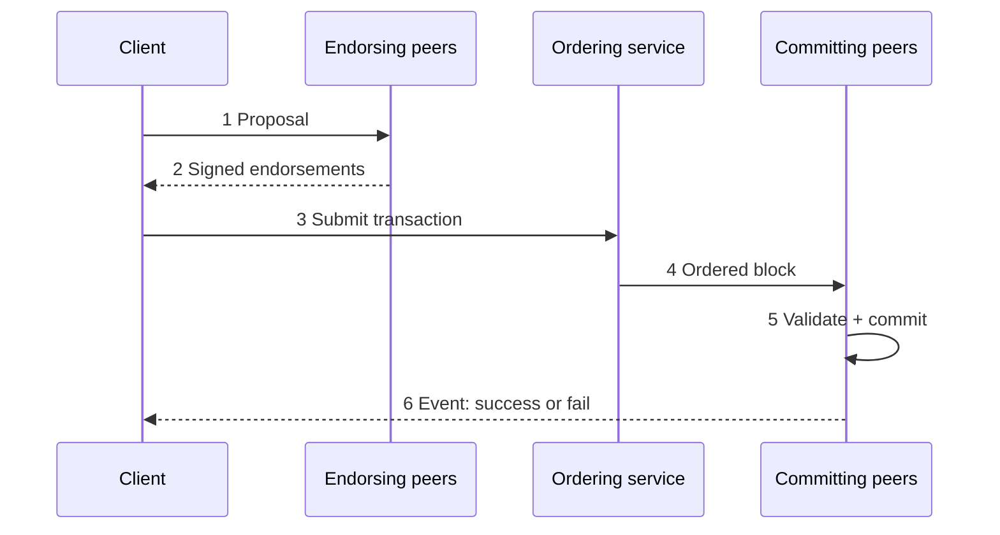

**In simple words:** private blockchain mein transaction known members se guzarta hai jo use check karte hain, phir ordering step, aur save hone se pehle aakhri check. Hyperledger Fabric standard example hai, isliye neeche ke steps usi ke hain.

**Lifecycle (Fabric: execute, order, validate):**

1. **Proposal.** Client application transaction proposal sign karke endorsement policy mein bataye endorsing peers ko bhejti hai.
2. **Endorsement.** Har endorsing peer client ki identity check karta hai, chaincode ko current world state pe chalata hai (state badle bina), aur read-write set ke saath signed result lautata hai.
3. **Endorsements collect.** Client check karta hai ki responses match karte hain aur kaafi signatures jama karta hai.
4. **Ordering ko submit.** Client endorsed transaction ordering service ko bhejta hai.
5. **Ordering.** Orderers transactions ko ek agreed sequence mein rakhte hain aur block banate hain (Raft se). Wo contents nahi dekhte. <Cite id="hyperledger-fabric-ordering" />
6. **Distribution.** Block channel ke saare peers ko deliver hota hai.
7. **Validation.** Har peer check karta hai ki endorsement policy poori hui aur read set simulation ke baad se badla nahi (koi conflict nahi). Kharab transactions invalid mark hote hain lekin block mein rehte hain.
8. **Commit.** Valid writes world state update karte hain; block ledger mein append hota hai.
9. **Notification.** Peer client ko result batata hai. <Cite id="private-blockchain-fabric-txflow" />

<Figure caption="Endorsement ordering se pehle hota hai; validation aur commit har peer pe hota hai.">

</Figure>

**Public chains se fark:** mining nahi, parties known hain, aur finality turant milti hai (confirmations ka wait nahi). <Cite id="private-blockchain-gfg-private" />

**Conclusion:** pehle execute, phir order, aakhir mein validate; isse private chains fast aur consistent rehti hain. <Cite id="hyperledger-fabric-gfg-fabric" />
