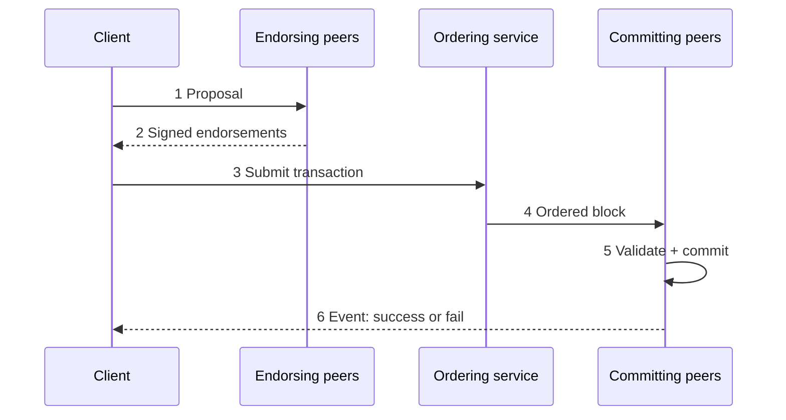

**In simple words:** in a private blockchain a transaction passes through known members who check it, an ordering step, and a final check before it is saved. Hyperledger Fabric is the standard example, so the steps below follow it.

**Lifecycle (Fabric: execute, order, validate):**

1. **Proposal.** The client application signs a transaction proposal and sends it to the endorsing peers named in the endorsement policy.
2. **Endorsement.** Each endorsing peer checks the client's identity, runs the chaincode against its current world state (without changing it), and returns a signed result with a read-write set.
3. **Collect endorsements.** The client checks the responses match and gathers enough signatures.
4. **Submit to ordering.** The client sends the endorsed transaction to the ordering service.
5. **Ordering.** Orderers put transactions into one agreed sequence and cut them into a block (using Raft). They do not look at the contents. <Cite id="hyperledger-fabric-ordering" />
6. **Distribution.** The block is delivered to all peers of the channel.
7. **Validation.** Each peer checks the endorsement policy is met and that the read set has not changed since simulation (no conflict). Bad transactions are marked invalid but stay in the block.
8. **Commit.** Valid writes update the world state; the block is appended to the ledger.
9. **Notification.** The peer tells the client the result. <Cite id="private-blockchain-fabric-txflow" />

<Figure caption="Endorsement happens before ordering; validation and commit happen at every peer.">

</Figure>

**Difference from public chains:** no mining, parties are known, and finality is immediate (no waiting for confirmations). <Cite id="private-blockchain-gfg-private" />

**Conclusion:** execute first, order second, validate last; this keeps private chains fast and consistent. <Cite id="hyperledger-fabric-gfg-fabric" />
