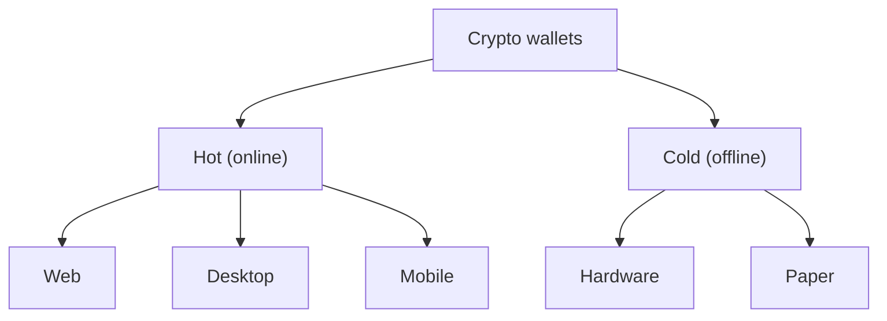

**In simple words:** crypto wallet coins hold nahi karta. Wo private keys rakhta hai jo prove karti hain ki blockchain pe coins aapke hain. Alag wallets keys ko alag tareeke se store karte hain.

**Definition:** wallet software ya hardware hai jo private keys store karta hai, addresses banata hai, transactions sign karta hai aur balance dikhata hai. <Cite id="wallets-utxo-double-spending-wiki-crypto-wallet" />

**Connection ke hisaab se types:**

1. **Hot wallets (internet se connected).** Aasan aur tez, lekin hackers ke saamne exposed.
   - *Web wallets:* browser ya exchange pe chalte hain. Provider aapki keys rakh sakta hai.
   - *Desktop wallets:* PC pe install (Electrum).
   - *Mobile wallets:* phone apps (Trust Wallet, MetaMask mobile).
2. **Cold wallets (offline).** Badi savings ke liye safer, kam convenient.
   - *Hardware wallets:* chhota device jo keys andar rakhta hai aur offline sign karta hai (Ledger, Trezor).
   - *Paper wallets:* keys paper pe print. Kho jaana ya kharab hona aasan.
   - *Air-gapped computers.* <Cite id="wallets-utxo-double-spending-gfg-hot-cold" />

**Key control ke hisaab se types:**

- *Custodial:* third party (exchange) aapki keys rakhta hai. "Not your keys, not your coins."
- *Non-custodial:* aap keys aur seed phrase khud rakhte ho.

**Key structure ke hisaab se types:**

- *Non-deterministic (random keys):* har key alag; backup mushkil.
- *Hierarchical deterministic (HD):* 12 ya 24 words ka ek seed phrase (BIP 39) saari keys banata hai (BIP 32), isliye ek backup kaafi hai. <Cite id="wallets-utxo-double-spending-bip39" />

Saath mein *full-node wallets* (sab verify karte hain) versus *SPV/light wallets* (Merkle proofs se verify). <Cite id="wallets-utxo-double-spending-mb-ch05-wallets" />

<Figure caption="Amount badhne ke saath hot se cold ki taraf jao.">

</Figure>

| Point | Hot wallet | Cold wallet |
|---|---|---|
| Internet | Connected | Offline |
| Security | Kam | Zyada |
| Convenience | High | Low |
| Best for | Roz ka kharch | Long-term savings |

<Cite id="wallets-utxo-double-spending-bitcoin-org-wallet" />

**Conclusion:** security versus ease dekhkar chuno; seed phrase safe aur offline rakho.
