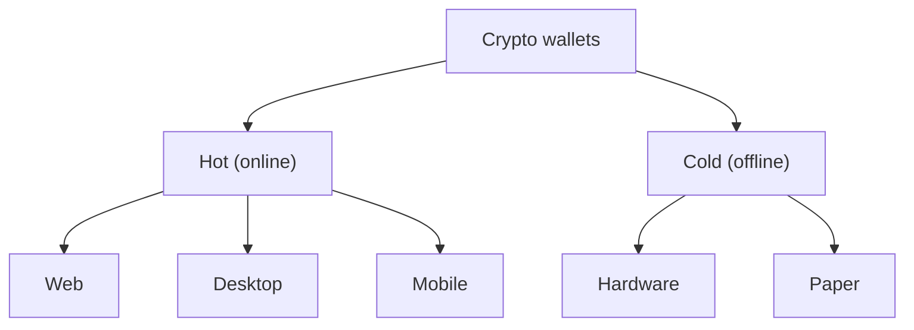

**In simple words:** a crypto wallet does not hold coins. It holds the private keys that prove you own coins on the blockchain. Different wallets store those keys in different ways.

**Definition:** a wallet is software or hardware that stores private keys, creates addresses, signs transactions and shows balances. <Cite id="wallets-utxo-double-spending-wiki-crypto-wallet" />

**Types by connection:**

1. **Hot wallets (connected to the internet).** Easy and fast, but exposed to hackers.
   - *Web wallets:* run in a browser or on an exchange. The provider may hold your keys.
   - *Desktop wallets:* installed on a PC (Electrum).
   - *Mobile wallets:* phone apps (Trust Wallet, MetaMask mobile).
2. **Cold wallets (offline).** Safer for large savings, less convenient.
   - *Hardware wallets:* a small device that keeps keys inside and signs offline (Ledger, Trezor).
   - *Paper wallets:* keys printed on paper. Easy to lose or damage.
   - *Air-gapped computers.* <Cite id="wallets-utxo-double-spending-gfg-hot-cold" />

**Types by key control:**

- *Custodial:* a third party (exchange) holds your keys. "Not your keys, not your coins."
- *Non-custodial:* you hold the keys and seed phrase.

**Types by key structure:**

- *Non-deterministic (random keys):* each key is separate; backups are hard.
- *Hierarchical deterministic (HD):* one seed phrase of 12 or 24 words (BIP 39) generates all keys (BIP 32), so one backup is enough. <Cite id="wallets-utxo-double-spending-bip39" />

Also *full-node wallets* (verify everything) versus *SPV/light wallets* (verify with Merkle proofs). <Cite id="wallets-utxo-double-spending-mb-ch05-wallets" />

<Figure caption="Move from hot to cold as the amount grows.">

</Figure>

| Point | Hot wallet | Cold wallet |
|---|---|---|
| Internet | Connected | Offline |
| Security | Lower | Higher |
| Convenience | High | Low |
| Best for | Daily spending | Long-term savings |

<Cite id="wallets-utxo-double-spending-bitcoin-org-wallet" />

**Conclusion:** choose by security versus ease; keep the seed phrase safe and offline.
