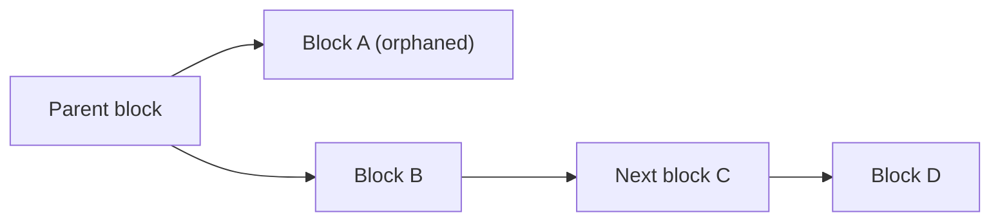

**In simple words:** kabhi kabhi do miners lagbhag ek hi time pe valid block dhoondh lete hain. Network sirf ek block rakhta hai. Jo block race haar jaata hai wo main chain ke bahar reh jaata hai. Ise log orphaned block kehte hain. <Cite id="consensus-mining-btcwiki-orphan" />

**Definition:** orphaned block ek valid block hai jo longest (main) chain ka hissa nahi hai, kyunki same height pe dusra block pehle accept ho gaya. Iske transactions wapas waiting pool (mempool) mein chale jaate hain aur orphan ke miner ka block reward chala jaata hai. Strictly, Bitcoin Core "orphan" us block ko kehta hai jiska parent abhi pata nahi, aur haare hue block ko "stale block" kehta hai; kai books aur exams dono ke liye "orphan" use karte hain. <Cite id="block-structure-merkle-btcwiki-orphan" />

**Ye kyun hota hai:** blocks ko duniya mein phailne mein time lagta hai. Door baithe do miners dono ek hi parent ke upar block bana lete hain, ek dusre ka block sunne se pehle. Chain thodi der ke liye split ho jaati hai (temporary fork).

**Ye kaise solve hota hai:**

1. Nodes jo block pehle sunte hain wo rakhte hain aur uske upar kaam karte hain.
2. Miners ab do branches mein se ek ko extend karte hain.
3. Jab ek branch lambi ho jaati hai, saare nodes us par switch kar jaate hain (longest-chain rule).
4. Chhoti branch orphaned ho jaati hai aur discard ho jaati hai. <Cite id="blockchain-fundamentals-nakamoto" loc="§5" />

**Effects:**

- Orphan ke miner ki mehnat waste hoti hai aur reward chala jaata hai.
- Usme ke transactions mempool mein wapas aate hain aur baad mein confirm hote hain.
- Isiliye shops payment ko final maanne se pehle kai confirmations ka wait karte hain. <Cite id="block-structure-merkle-gfg-conflicts" />

**Conclusion:** orphaned blocks decentralised network ka normal side effect hain aur longest-chain rule unhe automatically saaf kar deta hai.

Exam mein English mein likho: "An orphaned block is a valid block that is not part of the main chain because another block at the same height was accepted first."
