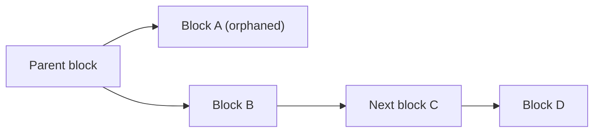

**In simple words:** sometimes two miners find a valid block at almost the same time. The network keeps only one of them. The block that loses the race is left outside the main chain. This is what people call an orphaned block. <Cite id="consensus-mining-btcwiki-orphan" />

**Definition:** an orphaned block is a valid block that is not part of the longest (main) chain, because another block at the same height was accepted first. Its transactions go back to the waiting pool (mempool) and the miner of the orphan loses the block reward. Strictly, Bitcoin Core uses "orphan" for a block whose parent is not yet known, and calls a losing block a "stale block"; many books and exams use "orphan" for both. <Cite id="block-structure-merkle-btcwiki-orphan" />

**Why it happens:** blocks take time to travel across the world. Two miners, far apart, may each find a block on top of the same parent before they hear about each other's block. The chain splits for a short while (a temporary fork).

**How it is resolved:**

1. Nodes keep the first block they hear and work on top of it.
2. Miners then extend one of the two branches.
3. When one branch becomes longer, every node switches to it (the longest-chain rule).
4. The shorter branch becomes orphaned and is discarded. <Cite id="blockchain-fundamentals-nakamoto" loc="§5" />

**Effects:**

- Miner of the orphan wastes work and loses the reward.
- Transactions in it return to the mempool and are confirmed later.
- This is why shops wait for several confirmations before treating a payment as final. <Cite id="block-structure-merkle-gfg-conflicts" />

**Conclusion:** orphaned blocks are a normal side effect of a decentralised network and are cleaned up automatically by the longest-chain rule.
