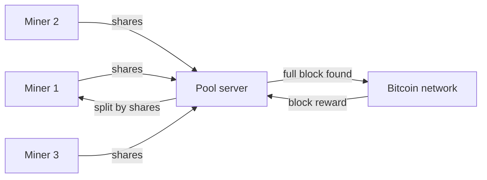

**In simple words:** mining ek lottery jaisi hai jisme akela miner bahut kam jeetta hai. Mining pool miners ka group hai jo apni computing power jodte hain aur inaam ko apne apne kaam ke hisaab se baant lete hain. Difficulty batati hai ki lottery kitni mushkil hai. <Cite id="consensus-mining-btcwiki-pooled" />

**Mining pool:** pool server apne saare members (miners) ko kaam ke chhote tukde deta hai. Members "shares" wapas bhejte hain, jo near-miss solutions hote hain aur proof dete hain ki asli kaam hua. Jab koi bhi member poora valid block dhoondh leta hai, reward members mein shares ke hisaab se baanta jaata hai, chhoti pool fee ke baad. <Cite id="consensus-mining-wiki-pool" />

**Pools kyun hain:** aaj ke bade network hash rate mein akele chhote miner ko ek block ke liye saalon wait karna pad sakta hai. Pool mein income chhoti par steady hoti hai.

**Reward sharing methods:** Pay Per Share (har share ka fixed pay), Proportional (us round ke shares ke hisaab se split) aur PPLNS (pay per last N shares).

**Disadvantage:** bahut bada pool ek operator ko zyada power deta hai aur decentralisation ko khatra hai (50% se upar ka pool 51% attack try kar sakta hai).

**Difficulty:** difficulty ek number hai jo batata hai ki target se chhota block hash dhoondhna kitna mushkil hai. Chhota target matlab zyada difficulty.

1. Bitcoin chahta hai ki lagbhag har 10 minute mein ek block bane.
2. Har 2016 blocks ke baad network real time ko expected 2016 x 10 minutes = 20160 minutes (do hafte) se compare karta hai.
3. Agar blocks jaldi aaye, difficulty badhti hai. Dheere aaye to ghatti hai (ek step mein change zyada se zyada 4 guna).
4. Isliye miners aaye to blocks der tak tez nahi rehte, aur miners gaye to der tak dheere nahi rehte. <Cite id="consensus-mining-btcwiki-difficulty" />

**Conclusion:** pools mining income ko steady banate hain, aur difficulty total mining power chahe jo ho block time ko 10 minute ke paas rakhti hai. <Cite id="bitcoin-tp-bitcoin-mining" />
