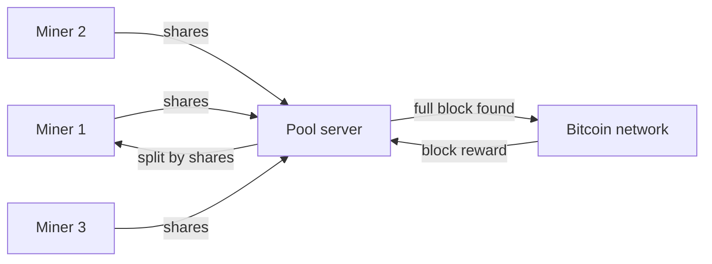

**In simple words:** mining is like a lottery where a single miner wins very rarely. A mining pool is a group of miners who join their computing power and share the prize in proportion to the work each did. Difficulty tells how hard the lottery is. <Cite id="consensus-mining-btcwiki-pooled" />

**Mining pool:** a pool server hands out small pieces of work to all its members (the miners). Members send back "shares", which are near-miss solutions that prove they did real work. When any member finds a full valid block, the reward is divided among members by their shares, after a small pool fee. <Cite id="consensus-mining-wiki-pool" />

**Why pools exist:** with the huge network hash rate today, a lone small miner may wait years for one block. In a pool the income is small but steady.

**Reward sharing methods:** Pay Per Share (fixed pay for each share), Proportional (split by shares in that round) and PPLNS (pay per last N shares).

**Disadvantage:** a very large pool gives too much power to one operator and threatens decentralisation (a pool above 50% could attempt a 51% attack).

**Difficulty:** the difficulty is a number showing how hard it is to find a block hash below the target. A smaller target means a higher difficulty.

1. Bitcoin wants one block about every 10 minutes.
2. Every 2016 blocks the network compares the real time taken with the expected 2016 x 10 minutes = 20160 minutes (two weeks).
3. If blocks came faster, difficulty rises. If slower, it falls (the change is limited to a factor of 4 in one step).
4. So if miners join, blocks do not speed up for long, and if miners leave, blocks do not stay slow. <Cite id="consensus-mining-btcwiki-difficulty" />

**Conclusion:** pools make mining income steady, and difficulty keeps block time near 10 minutes whatever the total mining power. <Cite id="bitcoin-tp-bitcoin-mining" />
