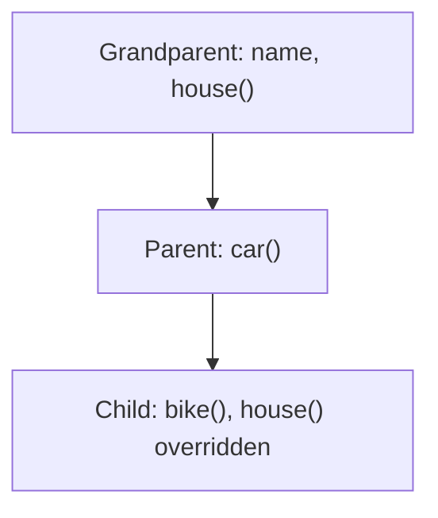

**In simple words:** inheritance se ek contract dusre contract ka code reuse kar sakta hai, jaise bachcha parent se cheezein paata hai. Multi-level inheritance mein ek chain hoti hai: contract A grandparent hai, contract B, A se inherit karta hai, aur contract C, B se inherit karta hai. To C ko B aur A dono ka sab kuch milta hai. <Cite id="solidity-docs-inheritance" />

Solidity mein keyword `is` se contract inherit karta hai. Jis function ko child badal sakta hai, use parent mein `virtual` mark karte hain, aur child ka naya version `override` mark hota hai.

```solidity
// SPDX-License-Identifier: MIT
pragma solidity ^0.8.0;

// Level 1: grandparent
contract Grandparent {
    string public name = "Grandparent";

    function house() public pure virtual returns (string memory) {
        return "House from Grandparent";
    }
}

// Level 2: parent inherits Grandparent
contract Parent is Grandparent {
    function car() public pure returns (string memory) {
        return "Car from Parent";
    }
}

// Level 3: child inherits Parent (and so Grandparent)
contract Child is Parent {
    function bike() public pure returns (string memory) {
        return "Bike from Child";
    }

    // Child changes the inherited house()
    function house() public pure override returns (string memory) {
        return "House (changed by Child)";
    }
}
```



**Line by line:**

- `pragma solidity ^0.8.0;` compiler version fix karta hai.
- `contract Grandparent` base contract hai, chain ke top pe.
- `string public name = "Grandparent";` ek state variable hai. `public` se Solidity khud getter function `name()` bana deta hai.
- `function house() public pure virtual returns (string memory)` ek text return karta hai. `virtual` matlab child is function ko replace kar sakta hai. `memory` batata hai ki text temporary memory mein hai.
- `contract Parent is Grandparent` matlab Parent, Grandparent ko inherit karta hai, isliye uske paas pehle se `name` aur `house()` hain. Ye `car()` add karta hai.
- `contract Child is Parent` matlab Child ko Parent ka sab kuch milta hai, jisme Grandparent ka bhi shamil hai. Ye second level ki inheritance hai, isliye chain teen contracts gehri hai.
- `function bike()` sirf Child ka naya function hai.
- `function house() ... override` inherited `house()` ko replace karta hai. `override` ke bina compiler error deta hai. <Cite id="solidity-gfg-inheritance" />

Sirf `Child` deploy karne pe uske address pe saare functions milte hain: `name()`, `house()`, `car()` aur `bike()`.

<Box kind="verify">

**`Child` deploy karke call karo:**

- `bike()` returns "Bike from Child" (apna function).
- `car()` returns "Car from Parent" (parent se).
- `name()` returns "Grandparent" (grandparent se).
- `house()` returns "House (changed by Child)", grandparent ka text nahi, kyunki Child ne override kiya.

Chaaron calls ek hi contract pe chalte hain, jisse dikhta hai ki teeno levels jude hain. Code solc 0.8.26 se compile hota hai.

</Box>

**Conclusion:** multi-level inheritance code ko repeat hone se bachata hai: common cheezein ek baar top pe likho aur special parts har neeche ke level pe jodo. <Cite id="solidity-tp-inheritance" />
