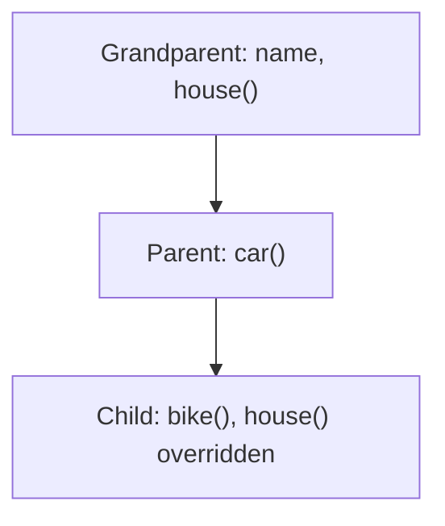

**In simple words:** inheritance lets one contract reuse the code of another, like a child inheriting things from a parent. In multi-level inheritance there is a chain: contract A is the grandparent, contract B inherits from A, and contract C inherits from B. So C gets everything from both B and A. <Cite id="solidity-docs-inheritance" />

In Solidity, the keyword `is` makes a contract inherit. A function that a child may change is marked `virtual` in the parent, and the child's new version is marked `override`.

```solidity
// SPDX-License-Identifier: MIT
pragma solidity ^0.8.0;

// Level 1: grandparent
contract Grandparent {
    string public name = "Grandparent";

    function house() public pure virtual returns (string memory) {
        return "House from Grandparent";
    }
}

// Level 2: parent inherits Grandparent
contract Parent is Grandparent {
    function car() public pure returns (string memory) {
        return "Car from Parent";
    }
}

// Level 3: child inherits Parent (and so Grandparent)
contract Child is Parent {
    function bike() public pure returns (string memory) {
        return "Bike from Child";
    }

    // Child changes the inherited house()
    function house() public pure override returns (string memory) {
        return "House (changed by Child)";
    }
}
```



**Line by line:**

- `pragma solidity ^0.8.0;` fixes the compiler version.
- `contract Grandparent` is the base contract at the top of the chain.
- `string public name = "Grandparent";` is a state variable. `public` makes Solidity create a getter function `name()` automatically.
- `function house() public pure virtual returns (string memory)` returns a text. `virtual` means a child is allowed to replace this function. `memory` says the text lives in temporary memory.
- `contract Parent is Grandparent` means Parent inherits Grandparent, so it already has `name` and `house()`. It adds `car()`.
- `contract Child is Parent` means Child gets everything from Parent, which already includes Grandparent's. It is the second level of inheritance, so the chain is three contracts deep.
- `function bike()` is a new function only in Child.
- `function house() ... override` replaces the inherited `house()`. Without `override`, the compiler gives an error. <Cite id="solidity-gfg-inheritance" />

When you deploy only `Child`, its address has all the functions: `name()`, `house()`, `car()` and `bike()`.

<Box kind="verify">

**Deploy `Child` and call:**

- `bike()` returns "Bike from Child" (own function).
- `car()` returns "Car from Parent" (from the parent).
- `name()` returns "Grandparent" (from the grandparent).
- `house()` returns "House (changed by Child)", not the grandparent's text, because Child overrode it.

All four calls work on one contract, which shows the three levels are joined. The code compiles with solc 0.8.26.

</Box>

**Conclusion:** multi-level inheritance avoids repeating code: write common things once at the top and add the special parts at each lower level. <Cite id="solidity-tp-inheritance" />
