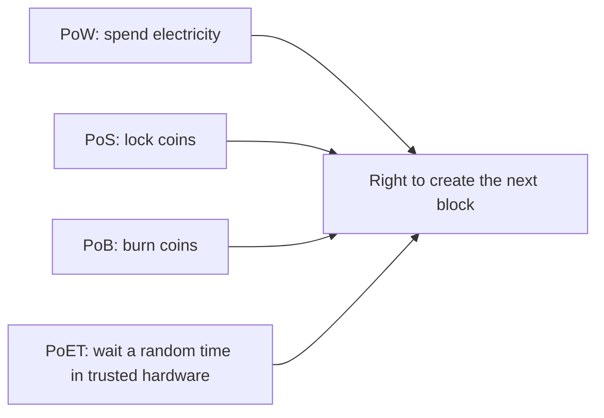

**In simple words:** chaaron ek hi sawaal ke alag jawab hain: "agla block kaun add karega, aur cheaters ko kaise rokein?" PoW computing work se jawab deta hai, PoS locked coins se, PoB burn kiye coins se aur PoET trusted random waiting timer se. <Cite id="consensus-mining-gfg-consensus" />

**Chaaron short mein:**

1. **Proof of Work (PoW).** Miners baar baar ek number (nonce) badalte hain jab tak block hash target se chhota na ho. Jo pehle dhoondhta hai wo block add karta hai aur reward paata hai. Bitcoin use karta hai. <Cite id="consensus-mining-wiki-pow" />
2. **Proof of Stake (PoS).** Validators coins stake ke roop mein lock karte hain. Stake ke hisaab se weighted ek validator agla block propose karne ke liye chuna jaata hai. Cheater apna kuch stake kho deta hai (slashing). Ethereum 2022 se use karta hai. <Cite id="consensus-mining-eth-pos" />
3. **Proof of Burn (PoB).** Miners coins aise address pe bhejte hain jahan se koi spend nahi kar sakta. Burn kiye coins payment ki tarah kaam karte hain, aur jitna zyada burn karo, chune jaane ka chance utna badhta hai. Slimcoin use karta hai. <Cite id="consensus-mining-btcwiki-pob" />
4. **Proof of Elapsed Time (PoET).** Har node trusted hardware (jaise Intel SGX) se random waiting time maangta hai aur so jaata hai. Jis node ka time pehle khatam hota hai wo block banata hai. Mostly permissioned networks mein, jaise Hyperledger Sawtooth. <Cite id="consensus-mining-gfg-crypto-consensus" />

| Point | PoW | PoS | PoB | PoET |
|---|---|---|---|---|
| Resource used | Computing power | Staked coins | Burned coins | Random wait inside trusted hardware |
| Selection | First to solve the puzzle | Random, weighted by stake | Chance rises with coins burned | Shortest wait wins |
| Energy use | Very high | Low | Low (but the coins are lost) | Very low |
| Hardware need | Powerful miners (ASIC) | Normal computer | Normal computer | Special CPU (Intel SGX) |
| Cheating cost | Wasted electricity | Slashing of stake | Burned coins are gone | Needs breaking the hardware |
| Weakness | Waste of energy, mining centralises | The rich get richer | Wastes coins, little used | Trust in the hardware maker |
| Network type | Public | Public | Public | Permissioned |
| Example | Bitcoin | Ethereum | Slimcoin | Hyperledger Sawtooth |

**Conclusion:** PoW sabse zyada tested hai par mehenga, PoS energy bachata hai, PoB burn kiye coins ko price banata hai, aur PoET trusted business networks ke liye sasti lottery hai.
