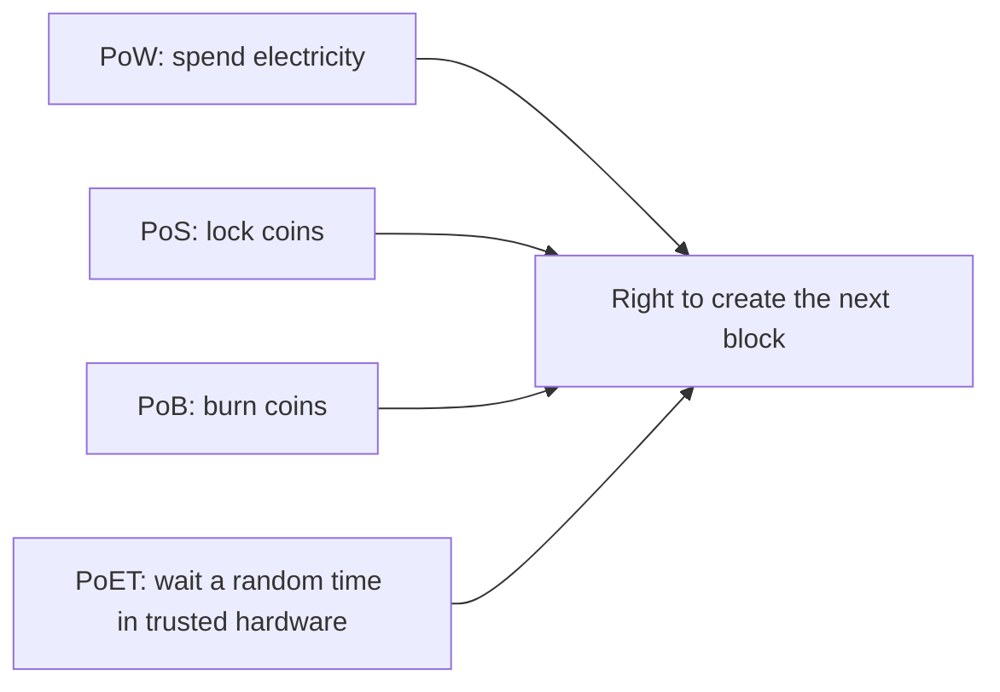

**In simple words:** all four are different answers to one question: "who gets to add the next block, and how do we stop cheaters?" PoW answers with computing work, PoS with locked coins, PoB with burned coins and PoET with a trusted random waiting timer. <Cite id="consensus-mining-gfg-consensus" />

**The four in short:**

1. **Proof of Work (PoW).** Miners repeatedly change a number (the nonce) until the block hash is below a target. The first to find it adds the block and earns a reward. Used by Bitcoin. <Cite id="consensus-mining-wiki-pow" />
2. **Proof of Stake (PoS).** Validators lock coins as a stake. One is chosen, weighted by stake, to propose the next block. A cheater loses part of the stake (slashing). Used by Ethereum since 2022. <Cite id="consensus-mining-eth-pos" />
3. **Proof of Burn (PoB).** Miners send coins to an address nobody can spend from. The burned coins act as a payment, and the more you burn, the better the chance to be chosen. Used by Slimcoin. <Cite id="consensus-mining-btcwiki-pob" />
4. **Proof of Elapsed Time (PoET).** Each node asks trusted hardware (such as Intel SGX) for a random waiting time and sleeps. The node whose time ends first creates the block. Used mostly in permissioned networks such as Hyperledger Sawtooth. <Cite id="consensus-mining-gfg-crypto-consensus" />

| Point | PoW | PoS | PoB | PoET |
|---|---|---|---|---|
| Resource used | Computing power | Staked coins | Burned coins | Random wait inside trusted hardware |
| Selection | First to solve the puzzle | Random, weighted by stake | Chance rises with coins burned | Shortest wait wins |
| Energy use | Very high | Low | Low (but the coins are lost) | Very low |
| Hardware need | Powerful miners (ASIC) | Normal computer | Normal computer | Special CPU (Intel SGX) |
| Cheating cost | Wasted electricity | Slashing of stake | Burned coins are gone | Needs breaking the hardware |
| Weakness | Waste of energy, mining centralises | The rich get richer | Wastes coins, little used | Trust in the hardware maker |
| Network type | Public | Public | Public | Permissioned |
| Example | Bitcoin | Ethereum | Slimcoin | Hyperledger Sawtooth |

**Conclusion:** PoW is the most tested but costly, PoS saves energy, PoB uses burned coins as the price, and PoET is a cheap lottery for trusted business networks.
