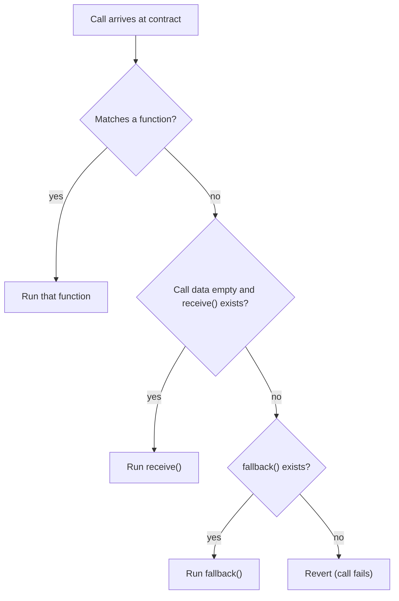

**In simple words:** fallback function ek special function hai jiska koi naam nahi hota. Solidity ise tab chalata hai jab koi contract ko aise call kare jo kisi aur function se match na kare, jaise aisa function call karna jo exist nahi karta, ya aisa data ke saath Ether bhejna jise koi function handle nahi kar sakta. Ye contract ka "catch-all" darwaza hai. <Cite id="solidity-docs-fallback" />

**Fallback function kab call hota hai?**

1. Call aisi function signature use kare jo contract mein nahi hai.
2. Bina function call ke Ether bheja jaye aur contract mein `receive` function na ho (purane code mein fallback isi ke liye bhi use hota tha).
3. Data ke saath Ether bheja jaye, aur koi function match na kare.

**Rules:**

- `fallback() external` ya `fallback() external payable` ki tarah likhte hain (Solidity 0.6 se; pehle ye bina naam ka `function() external` tha).
- `external` hona chahiye aur naam nahi hota. Simple form mein koi argument nahi leta aur kuch return nahi karta (`bytes calldata` input aur `bytes memory` output wala form bhi hota hai).
- Ether lene ke liye `payable` mark hona chahiye. Uske bina unknown call ke saath Ether bhejna reject ho jaata hai.
- Alag `receive() external payable` function khaali call data wale plain Ether transfers handle karta hai. Agar `receive` hai to plain transfer wahan jaata hai, aur fallback baaki sab pakadta hai.
- `send` ya `transfer` se pahunchne pe isse thodi gas milti hai (2300 gas), isliye ise chhota rakho. <Cite id="solidity-gfg-fallback" />



**Example:**

```solidity
// SPDX-License-Identifier: MIT
pragma solidity ^0.8.0;

contract Wallet {
    event Received(address indexed from, uint256 amount);
    event FallbackCalled(address indexed from, uint256 amount, bytes data);

    // Runs when plain ether arrives with empty calldata.
    receive() external payable {
        emit Received(msg.sender, msg.value);
    }

    // Runs when the called function does not exist.
    fallback() external payable {
        emit FallbackCalled(msg.sender, msg.value, msg.data);
    }

    function balance() public view returns (uint256) {
        return address(this).balance;
    }
}
```

**Line by line:**

- `event Received(...)` aur `event FallbackCalled(...)` log messages define karte hain. Events sasti records hain jo apps blockchain se padh sakte hain.
- `receive() external payable` bina data ke plain Ether transfer pe chalta hai. `payable` use Ether lene deta hai. `msg.sender` caller hai aur `msg.value` bheja gaya Wei (Ether ki sabse chhoti unit) hai.
- `fallback() external payable` tab chalta hai jab call data kisi function se match nahi karta. `msg.data` mein poora call data hota hai, jo log hota hai.
- `balance()` ek `view` function hai jo `address(this).balance` se contract ka Ether balance padhta hai.

<Box kind="verify">

**Remix mein test:**

1. Khaali data ke saath 1 Ether bhejo: `receive()` chalta hai aur `Received` log karta hai. `balance()` returns 1 Ether (10^18 Wei).
2. Data `0x12345678` (jo function exist nahi karta) ke saath 0.5 Ether bhejo: `fallback()` chalta hai aur wo data ke saath `FallbackCalled` log karta hai. `balance()` 1.5 Ether ho jaata hai.
3. `balance()` khud call karo: ye real function se match karta hai, isliye dono special functions nahi chalte.

Contract solc 0.8.26 se compile hota hai.

</Box>

**Uses aur risk:** fallbacks proxy contracts mein use hote hain jo calls dusre contract ko forward karte hain, aur Ether safely lene ke liye. Inme heavy logic mat daalo: isse Ether bhejna mehenga hota hai aur reentrancy jaise attack raste khul sakte hain. <Cite id="solidity-by-example" />

**Conclusion:** fallback function unknown calls ke liye contract ka default handler hai aur `payable` ke saath unmatched data ke saath aaye Ether ke liye bhi.
