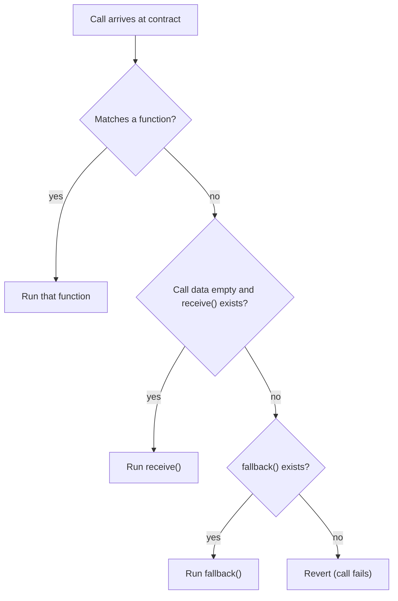

**In simple words:** a fallback function is a special function with no name. Solidity runs it when somebody calls the contract in a way that no other function matches, for example calling a function that does not exist, or sending Ether with data that no function can handle. It is the "catch-all" door of a contract. <Cite id="solidity-docs-fallback" />

**When is the fallback function called?**

1. A call uses a function signature that does not exist in the contract.
2. Ether is sent with no function call and the contract has no `receive` function (older code used the fallback for this too).
3. Ether is sent to a contract with data, and no function matches.

**Rules:**

- Written as `fallback() external` or `fallback() external payable` (since Solidity 0.6; before that it was a nameless `function() external`).
- Must be `external` and has no name. In the simple form it takes no arguments and returns nothing (a form with `bytes calldata` input and `bytes memory` output also exists).
- It must be marked `payable` to accept Ether. Without it, sending Ether with an unknown call is rejected.
- A separate `receive() external payable` function handles plain Ether transfers with empty call data. If `receive` exists, a plain transfer goes there, and the fallback gets everything else.
- It gets little gas when reached through `send` or `transfer` (2300 gas), so keep it short. <Cite id="solidity-gfg-fallback" />



**Example:**

```solidity
// SPDX-License-Identifier: MIT
pragma solidity ^0.8.0;

contract Wallet {
    event Received(address indexed from, uint256 amount);
    event FallbackCalled(address indexed from, uint256 amount, bytes data);

    // Runs when plain ether arrives with empty calldata.
    receive() external payable {
        emit Received(msg.sender, msg.value);
    }

    // Runs when the called function does not exist.
    fallback() external payable {
        emit FallbackCalled(msg.sender, msg.value, msg.data);
    }

    function balance() public view returns (uint256) {
        return address(this).balance;
    }
}
```

**Line by line:**

- `event Received(...)` and `event FallbackCalled(...)` define log messages. Events are cheap records that apps can read from the blockchain.
- `receive() external payable` runs for a plain Ether transfer with no data. `payable` lets it accept Ether. `msg.sender` is the caller and `msg.value` is the Wei (smallest Ether unit) sent.
- `fallback() external payable` runs when the call data does not match any function. `msg.data` holds the full call data, which is logged.
- `balance()` is a `view` function that reads the contract's Ether balance with `address(this).balance`.

<Box kind="verify">

**Test in Remix:**

1. Send 1 Ether with empty data: `receive()` runs and logs `Received`. `balance()` returns 1 Ether (10^18 Wei).
2. Send 0.5 Ether with data `0x12345678` (a function that does not exist): `fallback()` runs and logs `FallbackCalled` with that data. `balance()` becomes 1.5 Ether.
3. Call `balance()` itself: it matches a real function, so neither special function runs.

The contract compiles with solc 0.8.26.

</Box>

**Uses and risk:** fallbacks are used for proxy contracts that forward calls to another contract, and to accept Ether safely. Do not put heavy logic in them: it makes sending Ether costly and can open attack routes such as reentrancy. <Cite id="solidity-by-example" />

**Conclusion:** the fallback function is the contract's default handler for unknown calls and, with `payable`, for Ether that arrives with unmatched data.
