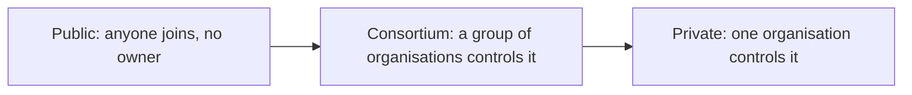

**In simple words:** teenon mein ek hi fark hai: kaun join kar sakta hai, padh sakta hai aur likh sakta hai. Public blockchain public park jaisi hai, sabke liye open. Private blockchain company ke office jaisi hai, ek owner chalata hai. Consortium blockchain kuch companies ki shared club building jaisi hai. <Cite id="blockchain-fundamentals-gfg-types" />

**Public blockchain:** koi bhi bina permission ke join kar sakta hai, ledger padh sakta hai, transactions bhej sakta hai aur consensus mein hissa le sakta hai. Iska koi owner nahi. Examples: Bitcoin aur Ethereum. Consensus aam taur pe PoW ya PoS. Bahut decentralised aur transparent, par dheema aur zyada resources khaata hai. <Cite id="private-blockchain-gfg-pubpriv" />

**Private blockchain:** ek organisation control karti hai ki kaun join kare aur kaun likhe ya padhe. Tez aur sasti, privacy ke saath, par centralised hai, isliye trust owner pe hota hai. Example: bank ka internal ledger. <Cite id="private-blockchain-gfg-private" />

**Consortium blockchain:** organisations ka ek group milke network control karta hai. Kuch chune hue nodes blocks validate karte hain. Ye public aur private ke beech ka raasta hai, un industries ke liye acha jahan competitors ko data share karna padta hai. Examples: banks ke liye Hyperledger Fabric aur R3 Corda networks, supply chains. <Cite id="private-blockchain-gfg-consortium" />

| Point | Public | Private | Consortium |
|---|---|---|---|
| Who can join | Anyone | Only invited by one owner | Only approved members of the group |
| Control | No one (decentralised) | One organisation | Several organisations |
| Read access | Everyone | Restricted | Public or restricted |
| Write / validate | Any node | Selected by the owner | Pre-selected nodes |
| Consensus | PoW, PoS | PBFT, Raft, PoA | PBFT, Raft, PoA |
| Speed | Slow | Fast | Fast |
| Transparency | Very high | Low | Medium |
| Energy and cost | High | Low | Low |
| Trust model | Trust the code | Trust the owner | Trust the group |
| Examples | Bitcoin, Ethereum | Internal company ledger | Hyperledger Fabric, Corda |

**Uses:** public cryptocurrency aur open apps ke liye, private in-house record keeping aur audit ke liye, consortium banking, trade finance aur companies ke beech supply chain ke liye. <Cite id="blockchain-fundamentals-ibm-blockchain" />

**Conclusion:** type is hisaab se chuno ki openness aur control ka kitna balance chahiye: trustless openness ke liye public, speed aur privacy ke liye private, shared control ke liye consortium.
