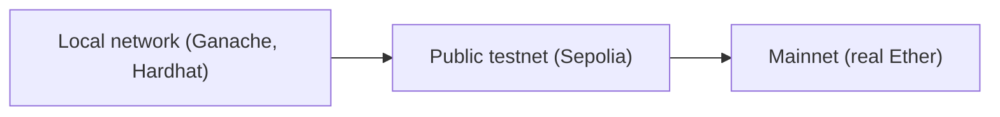

**In simple words:** test network (testnet) ek blockchain ki copy hai jo sirf practice ke liye use hoti hai. Ye asli network jaisa kaam karta hai, par uske coins ki koi value nahi. Developer wahan free mein smart contract deploy aur test kar sakta hai, aur galti karke paisa nahi khota. Asli network ko **mainnet** kehte hain. <Cite id="ethereum-eth-networks" />

**Testnets kyun zaroori hain:** deploy hua contract aasani se badla nahi ja sakta aur bugs mein asli paisa ja sakta hai. Isliye code pehle testnet pe try hota hai. Test Ether **faucet** (ek website jo test coins deti hai) se free milta hai. <Cite id="ethereum-alchemy-testnets" />

**Test networks ke types:**

1. **Local (private) networks.** Aapke apne computer pe blockchain, jaise **Ganache** ya Hardhat ka built-in node. Instant blocks, free, aasani se reset hota hai, par sirf aap use karte ho. <Cite id="ethereum-tp-ganache" />
2. **Public testnets.** Open networks jahan kai nodes hissa lete hain aur jo mainnet ke kareeb hain. Ye developers aur validators ke liye maintain hote hain.
3. **Developer networks (devnets).** Chhote time ke networks jo client teams naye upgrades try karne ke liye banati hain.

**Public Ethereum testnets:**

| Testnet | Consensus | Status and use |
|---|---|---|
| Ropsten | Proof of work | Retired |
| Kovan | Proof of authority | Retired |
| Rinkeby | Proof of authority | Retired |
| Goerli | Proof of authority (moved to proof of stake in 2022) | Retired |
| Sepolia | Proof of stake | Current. Recommended default for contract and app developers |
| Hoodi | Proof of stake | Current. For protocol developers and for stakers testing validators |

Ropsten, Kovan, Rinkeby aur Goerli purani books aur papers mein aate hain, isliye unhe jaano, par likho ki ab wo band ho chuke hain. <Cite id="ethereum-consensys-testnets" />

**Mainnet versus testnet:**

| Point | Mainnet | Testnet |
|---|---|---|
| Coin value | Real money | No value |
| Purpose | Live use | Testing and practice |
| Cost to get coins | Buy | Free from a faucet |
| Risk | Mistakes cost money | Safe to fail |

Dusri chains ke bhi testnets hote hain, jaise Bitcoin ke Testnet aur Signet.

**Conclusion:** pehle local pe test karo, phir Sepolia jaise public testnet pe, aur mainnet pe tabhi deploy karo jab contract sahi chale.
