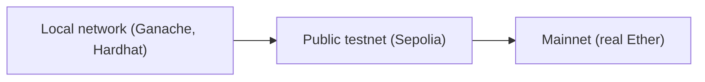

**In simple words:** a test network (testnet) is a copy of a blockchain used only for practice. It works like the real network, but its coins have no value. A developer can deploy and test a smart contract there for free, and make mistakes without losing money. The real network is called the **mainnet**. <Cite id="ethereum-eth-networks" />

**Why testnets are needed:** a deployed contract cannot be changed easily and bugs can cost real money. So code is tried on a testnet first. Test Ether is free from a **faucet** (a website that gives out test coins). <Cite id="ethereum-alchemy-testnets" />

**Types of test networks:**

1. **Local (private) networks.** A blockchain on your own computer, such as **Ganache** or Hardhat's built-in node. Instant blocks, free, resets easily, but only you use it. <Cite id="ethereum-tp-ganache" />
2. **Public testnets.** Open networks where many nodes take part and which are close to mainnet. They are maintained for developers and validators.
3. **Developer networks (devnets).** Short-lived networks created by client teams to try new upgrades.

**Public Ethereum testnets:**

| Testnet | Consensus | Status and use |
|---|---|---|
| Ropsten | Proof of work | Retired |
| Kovan | Proof of authority | Retired |
| Rinkeby | Proof of authority | Retired |
| Goerli | Proof of authority (moved to proof of stake in 2022) | Retired |
| Sepolia | Proof of stake | Current. Recommended default for contract and app developers |
| Hoodi | Proof of stake | Current. For protocol developers and for stakers testing validators |

Ropsten, Kovan, Rinkeby and Goerli appear in older books and papers, so know them, but say that they are now shut down. <Cite id="ethereum-consensys-testnets" />

**Mainnet versus testnet:**

| Point | Mainnet | Testnet |
|---|---|---|
| Coin value | Real money | No value |
| Purpose | Live use | Testing and practice |
| Cost to get coins | Buy | Free from a faucet |
| Risk | Mistakes cost money | Safe to fail |

Other chains also have testnets, for example Bitcoin has Testnet and Signet.

**Conclusion:** test locally first, then on a public testnet like Sepolia, and deploy to mainnet only when the contract works.
