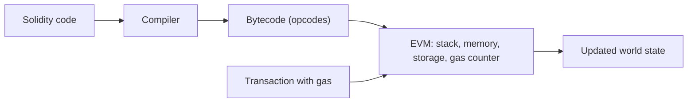

**In simple words:** Ethereum Virtual Machine (EVM) Ethereum ke andar ka computer hai jo smart contracts chalata hai. Har node ke paas iski copy hai, aur sab copies same code chalake same answer paati hain. Ye "virtual" isliye hai kyunki ye software hai, asli machine nahi. <Cite id="ethereum-eth-evm" />

**Definition:** EVM ek sandboxed, stack-based virtual machine hai jo contract bytecode execute karti hai aur Ethereum state update karti hai. Ye deterministic hai: same input har node pe hamesha same output deta hai. <Cite id="ethereum-gfg-evm" />

**Contract EVM tak kaise pahunchta hai:**

1. Developer Solidity mein contract likhta hai.
2. Compiler use **bytecode** mein badal deta hai (low-level instructions jinhe opcodes kehte hain, jaise ADD, PUSH, SSTORE).
3. Bytecode ek transaction mein deploy hota hai aur contract address pe store hota hai.
4. Jab koi transaction contract ko call karta hai, har node ki EVM bytecode chalati hai.
5. Result state (balances, storage) badalta hai aur change block mein record hota hai.

**EVM ke parts:**

- **Stack.** Chhota last-in-first-out area jahan operations values lete aur rakhte hain (1024 tak items, 256 bits ke).
- **Memory.** Temporary jagah jo har call ke baad saaf ho jaati hai.
- **Storage.** Contract ka permanent key-value storage, blockchain pe saved. Ye mehenga hai.
- **Calldata.** Call ka read-only input.
- **Program counter aur bytecode.** EVM ek time pe ek opcode padhti hai.
- **Gas counter.** Har opcode ki gas lagti hai, aur gas khatam hone pe run ruk jaata hai aur uske changes undo ho jaate hain. Isse infinite loops rukte hain. <Cite id="ethereum-eth-gas" />

**Features:** host machine se isolated, isliye kharab contract node ko nuksaan nahi pahunch sakta; deterministic; Turing complete (koi bhi computation chala sakti hai, sirf gas se limited); Vyper jaisi dusri languages bhi ise target kar sakti hain.

<Sum>

<Given>

Simple Ether transfer mein 21,000 gas lagti hai. Gas price 20 gwei per gas hai (1 gwei = 10^-9 ETH).

</Given>

<Find>

ETH mein fee.

</Find>

<Steps>

1. Fee = gas used x gas price. *Reason: aap kaam ki har unit ka offered price dete ho.*
2. Fee = 21,000 x 20 gwei = 420,000 gwei.
3. Convert: 420,000 x 10^-9 ETH = 0.00042 ETH.

</Steps>

<Answer>

fee = 0.00042 ETH

</Answer>

<Box kind="verify">

Ulta chalo: 0.00042 ETH = 420,000 gwei, aur 420,000 / 21,000 = 20 gwei per gas, yani shuru ki price.

</Box>

</Sum>

**Conclusion:** EVM shared, safe aur predictable engine hai jo Ethereum ko programmable banata hai. <Cite id="ethereum-sol-intro" />
