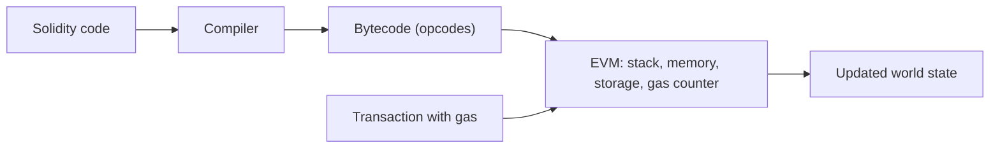

**In simple words:** the Ethereum Virtual Machine (EVM) is the computer inside Ethereum that runs smart contracts. Every node has a copy of it, and all copies run the same code and get the same answer. It is "virtual" because it is software, not a real machine. <Cite id="ethereum-eth-evm" />

**Definition:** the EVM is a sandboxed, stack-based virtual machine that executes contract bytecode and updates the Ethereum state. It is deterministic: the same input always gives the same output on every node. <Cite id="ethereum-gfg-evm" />

**How a contract reaches the EVM:**

1. The developer writes a contract in Solidity.
2. The compiler turns it into **bytecode** (low-level instructions called opcodes such as ADD, PUSH, SSTORE).
3. The bytecode is deployed in a transaction and stored at a contract address.
4. When a transaction calls the contract, each node's EVM runs the bytecode.
5. The result changes the state (balances, storage) and the change is recorded in a block.

**Parts of the EVM:**

- **Stack.** A small last-in-first-out area where operations take and put values (up to 1024 items of 256 bits).
- **Memory.** Temporary space that is cleared after each call.
- **Storage.** Permanent key-value storage of the contract, saved on the blockchain. It is costly.
- **Calldata.** The read-only input of the call.
- **Program counter and bytecode.** The EVM reads one opcode at a time.
- **Gas counter.** Every opcode costs gas, and when gas is finished the run stops and its changes are undone. This stops infinite loops. <Cite id="ethereum-eth-gas" />

**Features:** isolated from the host machine, so a bad contract cannot harm the node; deterministic; Turing complete (can run any computation, limited only by gas); other languages such as Vyper can also target it.

<Sum>

<Given>

A simple Ether transfer uses 21,000 gas. The gas price is 20 gwei per gas (1 gwei = 10^-9 ETH).

</Given>

<Find>

the fee in ETH.

</Find>

<Steps>

1. Fee = gas used x gas price. *Reason: you pay for each unit of work at the offered price.*
2. Fee = 21,000 x 20 gwei = 420,000 gwei.
3. Convert: 420,000 x 10^-9 ETH = 0.00042 ETH.

</Steps>

<Answer>

fee = 0.00042 ETH

</Answer>

<Box kind="verify">

Go backwards: 0.00042 ETH = 420,000 gwei, and 420,000 / 21,000 = 20 gwei per gas, the starting price.

</Box>

</Sum>

**Conclusion:** the EVM is the shared, safe and predictable engine that makes Ethereum programmable. <Cite id="ethereum-sol-intro" />
