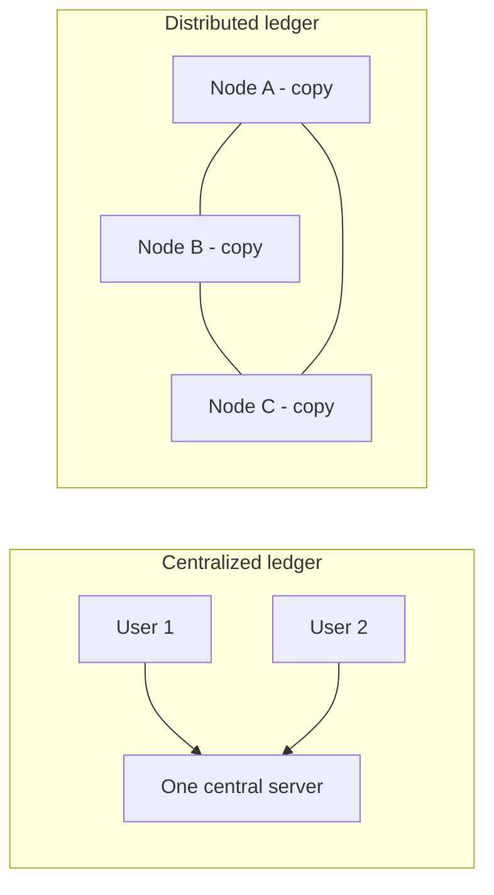

**In simple words:** distributed ledger ek record book (transactions ki list) hai jo kisi ek company ke server pe nahi rehti, balki **kai computers pe copy hoke sync mein rehti hai**. <Cite id="blockchain-fundamentals-wiki-dlt" />

**Definition:** distributed ledger ek shared database hai jo kai nodes (computers) pe replicate hota hai. Har node ke paas same data hota hai, aur ek rule (consensus) decide karta hai ki nayi entry sabke liye kaise accept hogi. Blockchain ek type ka distributed ledger hai, jisme entries blocks mein group hoti hain aur hashes se chain hoti hain. <Cite id="blockchain-fundamentals-ibm-blockchain" />

**Blockchain mein distributed ledger ki zaroorat:**

1. **Single point of failure nahi.** Ek node mar jaye to baaki nodes ke paas poora record hai. Bank ka server crash ho to sab ruk jaata hai; yahan nahi.
2. **Beech mein trusted middleman nahi.** Ajnabi log bina bank ke agree kar sakte hain ki kiska kya hai, kyunki har node same rules check karta hai. <Cite id="blockchain-fundamentals-nakamoto" />
3. **Tamper resistance.** Purani entry badalne ke liye attacker ko zyada tar nodes pe ek saath badalna padega, jo bahut mushkil hai.
4. **Transparency aur audit.** Sab participants same history dekhte hain, to jhagde aasani se sulajhte hain.
5. **Double spending rokta hai.** Sab same ledger dekhte hain, isliye ek coin do baar kharch karo to network ko pata chal jaata hai.

**Example:** Bitcoin mein hazaaron nodes transactions ki same list rakhte hain. <Cite id="blockchain-fundamentals-gfg-intro" />

**Conclusion:** distributed ledger blockchain ko trust, availability aur tamper resistance deta hai.
