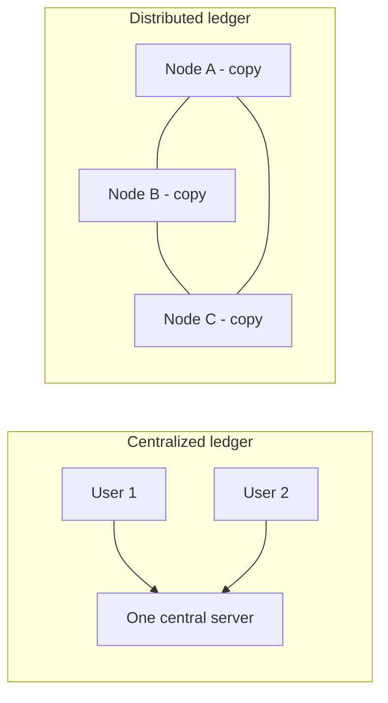

**In simple words:** a distributed ledger is a record book (a list of transactions) that is **copied and kept in sync on many computers** instead of sitting on one company's server. <Cite id="blockchain-fundamentals-wiki-dlt" />

**Definition:** a distributed ledger is a shared database replicated across many nodes (computers). Every node holds the same data, and a rule (consensus) decides how a new entry is accepted by all. A blockchain is one kind of distributed ledger, where entries are grouped in blocks and chained by hashes. <Cite id="blockchain-fundamentals-ibm-blockchain" />

**Need of a distributed ledger in blockchain:**

1. **No single point of failure.** If one node dies, the others still hold the full record. A bank server crash stops everything; here it does not.
2. **No trusted middleman.** Strangers can agree on who owns what without a bank, because every node checks the same rules. <Cite id="blockchain-fundamentals-nakamoto" />
3. **Tamper resistance.** To change an old entry, an attacker must change it on most nodes at once, which is very hard.
4. **Transparency and audit.** All participants see the same history, so disputes are easy to settle.
5. **Stops double spending.** Everyone sees the same ledger, so the same coin cannot be spent twice without the network noticing.

**Example:** in Bitcoin, thousands of nodes keep the same list of transactions. <Cite id="blockchain-fundamentals-gfg-intro" />

**Conclusion:** the distributed ledger gives blockchain its trust, availability and tamper resistance.
