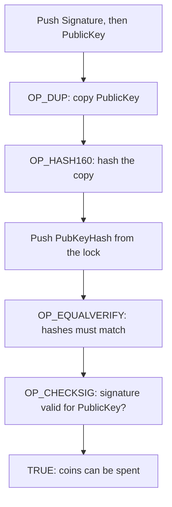

**In simple words:** Bitcoin Script har Bitcoin transaction ke andar ek chhota program hai jo batata hai ki **coins kharch karne ke liye kya dikhana padega**. Ise lock (rule) aur key (proof) ki tarah samjho. <Cite id="bitcoin-btcwiki-script" />

**Bitcoin Script:** ek simple, stack-based language (values stack pe rakhti hai aur har command stack ke top se values leti hai). Isme loops nahi hote, isliye ye hamesha khatam hoti hai, jo network ko safe rakhta hai. Har output mein ek **locking script** (scriptPubKey) hoti hai, aur har input mein ek **unlocking script** (scriptSig). Nodes dono ko saath chalate hain; result TRUE aaye to spend valid hai. <Cite id="bitcoin-mb-ch07-scripts" />

**P2PKH (Pay to Public Key Hash):** sabse common script. Coins **public key ke hash** se lock hote hain (yahi aapka address hai), key se khud nahi.

- Locking script: `OP_DUP OP_HASH160 <PubKeyHash> OP_EQUALVERIFY OP_CHECKSIG`
- Unlocking script: `<Signature> <PublicKey>`

**Example:** Ravi, Sita ko 0.5 BTC deta hai. Ravi ka output coins ko Sita ki public key ke hash se lock karta hai. Baad mein Sita apna signature aur public key dekar unhe kharch karti hai. Node uski public key ka hash nikalta hai, dekhta hai ki stored hash ke barabar hai, phir signature check karta hai. Bina private key ke koi aur valid signature nahi bana sakta. <Cite id="bitcoin-lmab-p2pkh" />

**Hash kyun:** public key kharch hone tak chhupi rehti hai, aur address chhota hota hai. <Cite id="bitcoin-og-p2pkh" />
