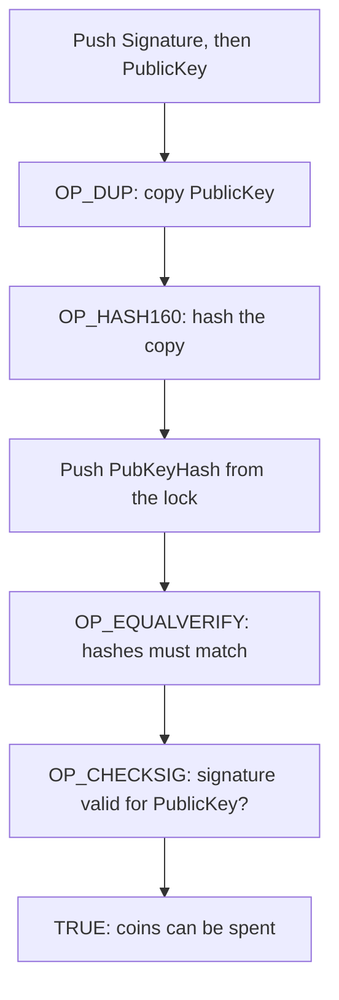

**In simple words:** Bitcoin Script is a tiny program inside every Bitcoin transaction that says **what you must show to be allowed to spend the coins**. Think of it as a lock (the rule) and a key (the proof). <Cite id="bitcoin-btcwiki-script" />

**Bitcoin Script:** a simple, stack-based language (it keeps values on a stack and each command takes values from the top). It has no loops, so it always ends, which keeps the network safe. Each output carries a **locking script** (scriptPubKey), and each input carries an **unlocking script** (scriptSig). Nodes run both together; if the result is TRUE, the spend is valid. <Cite id="bitcoin-mb-ch07-scripts" />

**P2PKH (Pay to Public Key Hash):** the most common script. The coins are locked to the **hash of a public key** (this is your address), not to the key itself.

- Locking script: `OP_DUP OP_HASH160 <PubKeyHash> OP_EQUALVERIFY OP_CHECKSIG`
- Unlocking script: `<Signature> <PublicKey>`

**Example:** Ravi pays Sita 0.5 BTC. Ravi's output locks the coins to the hash of Sita's public key. Later Sita spends them by giving her signature and public key. The node hashes her public key, sees it equals the stored hash, then checks her signature. Anyone else, without her private key, cannot make a valid signature. <Cite id="bitcoin-lmab-p2pkh" />

**Why a hash:** the public key stays hidden until spending, and the address is shorter. <Cite id="bitcoin-og-p2pkh" />
