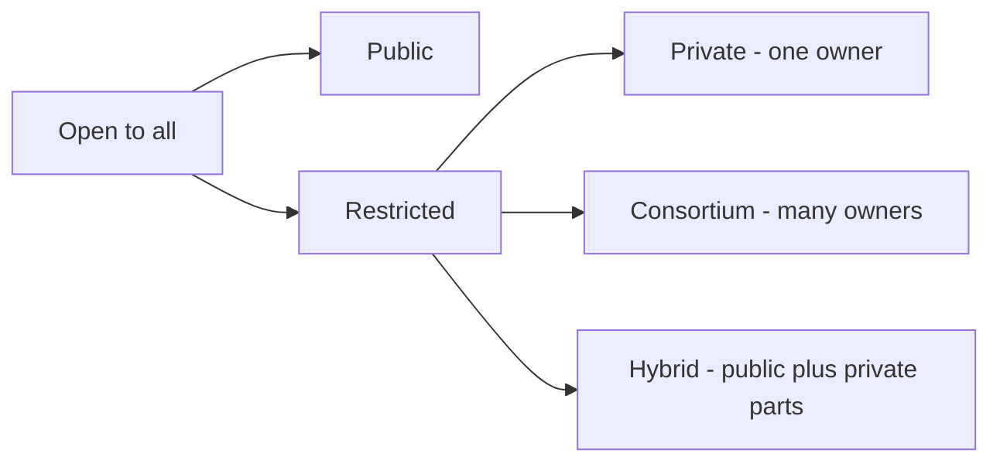

**In simple words:** blockchains is baat mein alag hote hain ki **kaun join kar sakta hai, kaun padh sakta hai aur kaun likh sakta hai**. Chaar types hain. <Cite id="blockchain-fundamentals-gfg-types" />

1. **Public blockchain:** sabke liye open. Koi bhi join, read aur validate kar sakta hai. Fully decentralized, transparent, lekin slow. Examples: Bitcoin, Ethereum.
2. **Private blockchain:** ek organization control karta hai ki kaun join karega. Fast aur zyada private, lekin kam decentralized. Example: company ka internal ledger. <Cite id="private-blockchain-gfg-pubpriv" />
3. **Consortium (federated) blockchain:** organizations ka ek group (jaise kai banks) milkar chalata hai. Partly decentralized. Examples: Hyperledger Fabric, R3 Corda. <Cite id="private-blockchain-gfg-consortium" />
4. **Hybrid blockchain:** public aur private ka mix. Kuch data private rehta hai, kuch public. Example: supply-chain system jo prices private rakhta hai lekin delivery ka proof publish karta hai.

| Point | Public | Private | Consortium | Hybrid |
|---|---|---|---|---|
| Who joins | Anyone | One organization permits | A group permits | Rules decide per data |
| Control | None | Single owner | Shared | Mixed |
| Speed | Slow | Fast | Fast | Fast to medium |
| Privacy | Low | High | Medium-high | Chosen |
| Consensus | PoW, PoS | PBFT, Raft | PBFT, Raft | Either |

**Conclusion:** ajnabiyon ke beech openness aur trust chahiye to public; jaane-pehchaane parties ke beech speed aur privacy chahiye to private, consortium ya hybrid chuno. <Cite id="blockchain-fundamentals-ibm-blockchain" />
