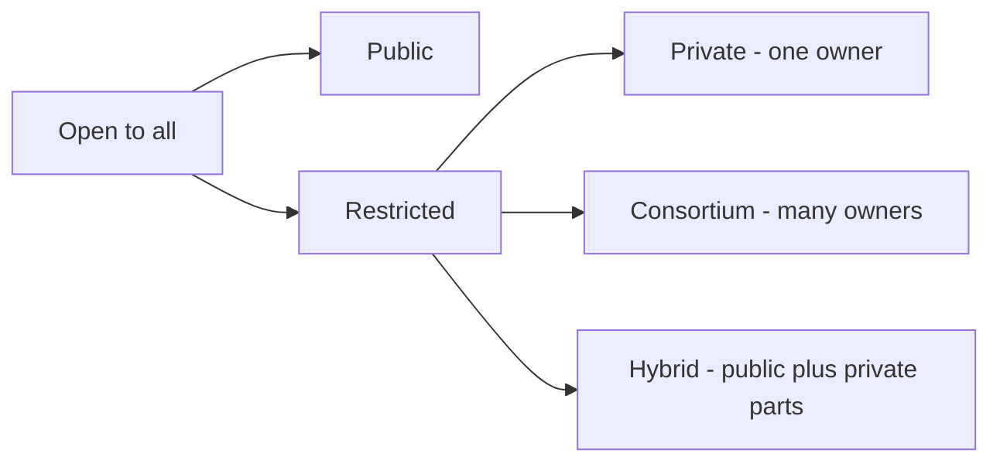

**In simple words:** blockchains differ in **who may join, who may read and who may write**. There are four types. <Cite id="blockchain-fundamentals-gfg-types" />

1. **Public blockchain:** open to everyone. Anyone can join, read and validate. Fully decentralized, transparent, but slower. Examples: Bitcoin, Ethereum.
2. **Private blockchain:** one organization controls who joins. Faster and more private, but less decentralized. Example: an internal ledger of a company. <Cite id="private-blockchain-gfg-pubpriv" />
3. **Consortium (federated) blockchain:** a group of organizations (such as several banks) runs it together. Partly decentralized. Examples: Hyperledger Fabric, R3 Corda. <Cite id="private-blockchain-gfg-consortium" />
4. **Hybrid blockchain:** mixes public and private. Some data stays private and some is public. Example: a supply-chain system that keeps prices private but publishes proof of delivery.

| Point | Public | Private | Consortium | Hybrid |
|---|---|---|---|---|
| Who joins | Anyone | One organization permits | A group permits | Rules decide per data |
| Control | None | Single owner | Shared | Mixed |
| Speed | Slow | Fast | Fast | Fast to medium |
| Privacy | Low | High | Medium-high | Chosen |
| Consensus | PoW, PoS | PBFT, Raft | PBFT, Raft | Either |

**Conclusion:** choose public for openness and trust among strangers, and private, consortium or hybrid for speed and privacy among known parties. <Cite id="blockchain-fundamentals-ibm-blockchain" />
