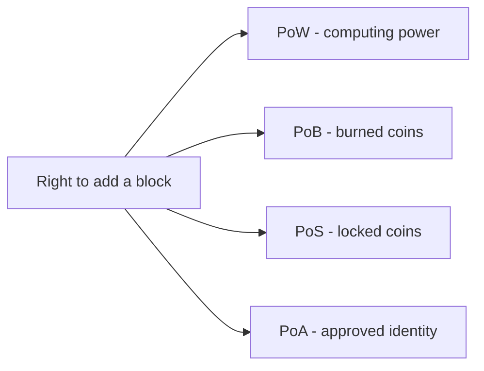

**In simple words:** consensus protocol woh rule hai jisse saare nodes agle block pe agree karte hain. Chaaron protocols mein fark ye hai ki **block add karne ka haq paane ke liye aapko kya daanv pe lagana padta hai**: computing power, jalaye hue coins, lock kiye hue coins ya achhi reputation. <Cite id="consensus-mining-gfg-consensus" />

**1. Proof of Work (PoW).** Miners block header ko ek badalte number (nonce) ke saath baar baar hash karte hain jab tak hash target se chhota na aa jaye. Jo pehle dhoondhta hai woh block add karta hai aur reward paata hai. Cheating ki cost bijli aur hardware hai. Bitcoin mein use hota hai. <Cite id="consensus-mining-wiki-pow" />

**2. Proof of Burn (PoB).** Miners coins ek aise address pe bhejte hain jahan se koi kharch nahi kar sakta (burn address). Burn karna lottery ka ticket kharidne jaisa hai: jitna zyada burn, utna zyada chance chune jaane ka. Cost hai hamesha ke liye khoye hue coins. Slimcoin mein use hua, aur Counterparty ke launch mein ek form mein. <Cite id="consensus-mining-gfg-pob" /> <Cite id="consensus-mining-btcwiki-pob" />

**3. Proof of Stake (PoS).** Validators deposit ke roop mein coins lock (stake) karte hain. Stake ke hisaab se ek ko agla block propose karne ke liye chuna jaata hai, aur baaki attest karte hain. Cheat karne wale validator ka stake kat jaata hai (slashing). Ethereum mein Merge (2022) ke baad se use hota hai. <Cite id="consensus-mining-eth-pos" />

**4. Proof of Authority (PoA).** Approved, jaane-pehchaane validators ki chhoti list baari baari se blocks sign karti hai. Unki identity aur reputation hi stake hai. Private aur test networks mein use hota hai, jaise Ethereum ke Goerli-era test chains aur VeChain. <Cite id="consensus-mining-eth-poa" />

| Point | PoW | PoB | PoS | PoA |
|---|---|---|---|---|
| Resource at stake | Hardware and electricity | Coins burned | Coins locked | Reputation and identity |
| Who can add blocks | Any miner | Anyone who burns | Anyone who stakes | Only approved validators |
| Energy use | Very high | Low | Low | Very low |
| Speed | Slow | Medium | Fast | Very fast |
| Decentralization | High | Medium | Medium-high | Low |
| Main risk | 51% hash power, energy waste | Wasted coins, early burners gain | Rich get richer, 51% stake | Few validators can collude |
| Network type | Public | Public | Public | Private or consortium |
| Example | Bitcoin | Slimcoin | Ethereum | VeChain |

**Conclusion:** PoW sabse proven hai lekin wasteful; PoB aur PoS energy ki jagah coins use karte hain; PoA sabse fast hai lekin kuch jaane-pehchaane parties pe trust karta hai. Openness versus speed ki zaroorat ke hisaab se chuno.
