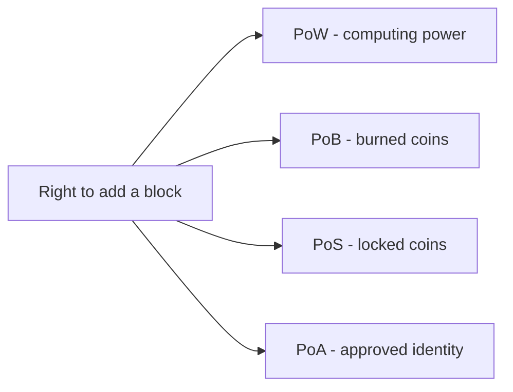

**In simple words:** a consensus protocol is the rule by which all nodes agree on the next block. The four protocols differ in **what you must put at stake to earn the right to add a block**: computing power, burned coins, locked coins or a good name. <Cite id="consensus-mining-gfg-consensus" />

**1. Proof of Work (PoW).** Miners repeatedly hash the block header with a changing number (nonce) until the hash is below a target. The first to find it adds the block and gets the reward. Cost of cheating is electricity and hardware. Used in Bitcoin. <Cite id="consensus-mining-wiki-pow" />

**2. Proof of Burn (PoB).** Miners send coins to an address nobody can spend from (a burn address). Burning is like buying a ticket in a lottery: the more you burn, the higher the chance to be chosen. Cost is the coins lost forever. Used in Slimcoin and, in a form, Counterparty's launch. <Cite id="consensus-mining-gfg-pob" /> <Cite id="consensus-mining-btcwiki-pob" />

**3. Proof of Stake (PoS).** Validators lock (stake) coins as a deposit. One is chosen, weighted by stake, to propose the next block, and others attest. A cheating validator loses part of the stake (slashing). Used in Ethereum since the Merge (2022). <Cite id="consensus-mining-eth-pos" />

**4. Proof of Authority (PoA).** A small list of approved, known validators sign blocks in turn. Their reputation and identity is the stake. Used in private and test networks, for example Ethereum's Goerli-era test chains and VeChain. <Cite id="consensus-mining-eth-poa" />

| Point | PoW | PoB | PoS | PoA |
|---|---|---|---|---|
| Resource at stake | Hardware and electricity | Coins burned | Coins locked | Reputation and identity |
| Who can add blocks | Any miner | Anyone who burns | Anyone who stakes | Only approved validators |
| Energy use | Very high | Low | Low | Very low |
| Speed | Slow | Medium | Fast | Very fast |
| Decentralization | High | Medium | Medium-high | Low |
| Main risk | 51% hash power, energy waste | Wasted coins, early burners gain | Rich get richer, 51% stake | Few validators can collude |
| Network type | Public | Public | Public | Private or consortium |
| Example | Bitcoin | Slimcoin | Ethereum | VeChain |

**Conclusion:** PoW is the most proven but wasteful; PoB and PoS replace energy with coins; PoA is the fastest but trusts a few known parties. Choose by the need for openness versus speed.
