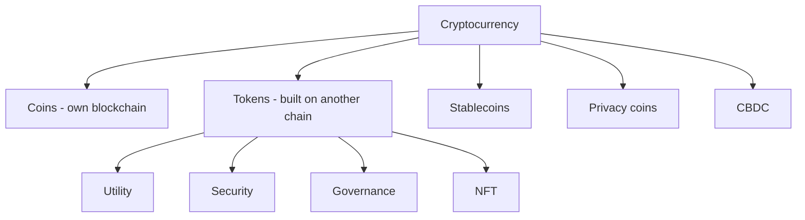

**In simple words:** cryptocurrency digital paisa hai jo cryptography se secure hai aur blockchain pe rakha jaata hai, beech mein bank ke bina. Iske kai types hain, jo is baat se group hote hain ki unka kaam kya hai. <Cite id="cryptocurrencies-tokens-wiki-crypto" />

**1. Coins (native currencies).** Ye apni khud ki blockchain pe chalte hain aur us network ka payment karte hain. Examples: Bitcoin (BTC) digital cash aur store of value hai; Ether (ETH) Ethereum pe gas pay karta hai; Litecoin (LTC) tez Bitcoin-jaisa coin hai. <Cite id="cryptocurrencies-tokens-gfg-coins-tokens" />

**2. Tokens.** Ye kisi aur blockchain pe rehte hain, aam taur pe Ethereum, aur smart contracts se bante hain. Types:
- **Utility tokens:** kisi service ka access dete hain (jaise Brave browser mein Basic Attention Token).
- **Security tokens:** ownership dikhate hain jaise shares ya bonds, aur securities law follow karte hain. <Cite id="cryptocurrencies-tokens-gfg-security-token" />
- **Governance tokens:** project pe voting ka haq dete hain (jaise UNI).
- **Non-fungible tokens (NFTs):** unique digital cheezein jaise art ya tickets.

**3. Stablecoins.** Inki price kisi stable asset se bandhi hoti hai taaki bade utaar-chadhaav na ho. Fiat-backed (USDT, USDC, dollars se backed), crypto-backed (DAI, extra crypto se backed) aur algorithmic (supply apne aap adjust hoti hai; kuch, jaise TerraUSD, collapse ho gaye). <Cite id="cryptocurrencies-tokens-wiki-stablecoin" />

**4. Privacy coins.** Sender, receiver aur amount chhupate hain. Example: Monero (XMR), Zcash (ZEC).

**5. Central bank digital currencies (CBDC).** Kisi desh ke paise ka digital form jo central bank jaari karta hai, jaise India ka e-rupee. Ye controlled hote hain, baaki cryptocurrencies ki tarah nahi.

**6. Meme coins.** Mazaak se shuru hue aur social media se chalte hain, jaise Dogecoin. Bahut risky.

| Type | Own chain? | Purpose | Example |
|---|---|---|---|
| Coin | Yes | Money, fees | BTC, ETH |
| Token | No | Access, ownership, voting | UNI, BAT |
| Stablecoin | Usually token | Steady price | USDC, DAI |
| Privacy coin | Yes | Hidden transactions | Monero |
| CBDC | Central bank system | Official digital money | e-rupee |

**Standards:** Ethereum ke zyada tar fungible tokens ERC-20 follow karte hain. <Cite id="cryptocurrencies-tokens-eth-erc20" />

**Conclusion:** har type alag zaroorat poori karta hai, payment se lekar ownership aur stability tak.
