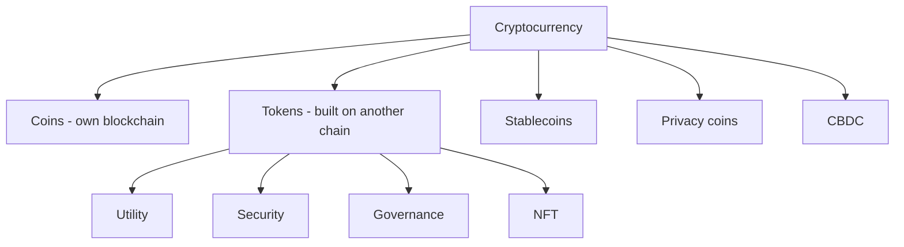

**In simple words:** a cryptocurrency is digital money secured by cryptography and kept on a blockchain, with no bank in the middle. There are many kinds, grouped by what they are meant to do. <Cite id="cryptocurrencies-tokens-wiki-crypto" />

**1. Coins (native currencies).** They run on their own blockchain and pay for that network. Examples: Bitcoin (BTC) is digital cash and store of value; Ether (ETH) pays gas on Ethereum; Litecoin (LTC) is a faster Bitcoin-like coin. <Cite id="cryptocurrencies-tokens-gfg-coins-tokens" />

**2. Tokens.** They live on another blockchain, usually Ethereum, created by smart contracts. Types:
- **Utility tokens:** give access to a service (for example Basic Attention Token in the Brave browser).
- **Security tokens:** represent ownership such as shares or bonds, and follow securities law. <Cite id="cryptocurrencies-tokens-gfg-security-token" />
- **Governance tokens:** give voting rights on a project (such as UNI).
- **Non-fungible tokens (NFTs):** unique digital items like art or tickets.

**3. Stablecoins.** Their price is tied to a stable asset to avoid wild swings. Fiat-backed (USDT, USDC, each backed by dollars), crypto-backed (DAI, backed by extra crypto) and algorithmic (supply adjusts automatically; some, like TerraUSD, collapsed). <Cite id="cryptocurrencies-tokens-wiki-stablecoin" />

**4. Privacy coins.** Hide the sender, receiver and amount. Example: Monero (XMR), Zcash (ZEC).

**5. Central bank digital currencies (CBDC).** Digital form of a country's money issued by the central bank, for example India's e-rupee. They are controlled, unlike other cryptocurrencies.

**6. Meme coins.** Started as jokes and driven by social media, such as Dogecoin. Very risky.

| Type | Own chain? | Purpose | Example |
|---|---|---|---|
| Coin | Yes | Money, fees | BTC, ETH |
| Token | No | Access, ownership, voting | UNI, BAT |
| Stablecoin | Usually token | Steady price | USDC, DAI |
| Privacy coin | Yes | Hidden transactions | Monero |
| CBDC | Central bank system | Official digital money | e-rupee |

**Standards:** most Ethereum fungible tokens follow ERC-20. <Cite id="cryptocurrencies-tokens-eth-erc20" />

**Conclusion:** each type solves a different need, from payment to ownership to stability.
