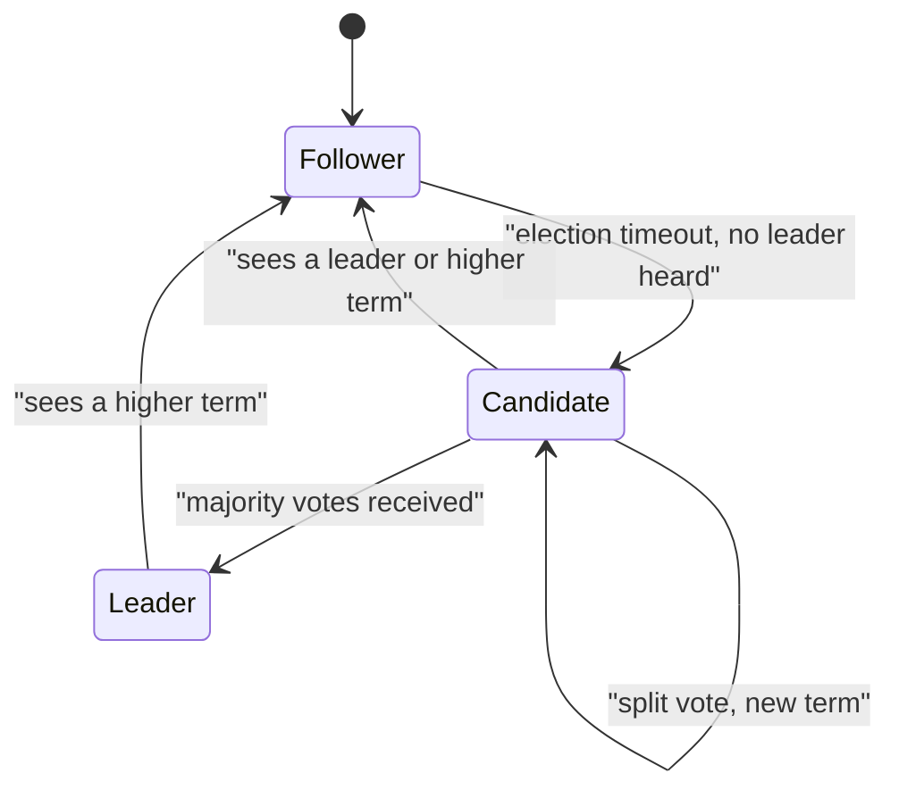

**In simple words:** Raft ek consensus algorithm hai jo servers ke group ko **commands ka same log** rakhne deta hai, chahe kuch servers crash ho jayein. Ise Paxos se aasan samajhne ke liye design kiya gaya tha. Ek server **leader** hota hai aur baaki uske **followers**. <Cite id="bft-paxos-raft-raft-paper" />

**Ye kyun zaroori hai:** distributed system mein har server ko same commands same order mein apply karne hote hain. Raft ise tab bhi safe banata hai jab servers ka minority fail ho jaye. Ye sirf crash faults handle karta hai, jhooth bolne wale (Byzantine) nodes nahi. <Cite id="bft-paxos-raft-raft-site" />

**Roles.** Har server teen states mein se ek mein hota hai:
- **Follower:** passive, leader aur candidates ko jawab deta hai.
- **Candidate:** follower jo leader banna chahta hai.
- **Leader:** client requests leta hai, apne log mein add karta hai aur followers ko copy karta hai.

Time ko **terms** mein baanta jaata hai (numbered 1, 2, 3...). Har term mein zyada se zyada ek leader.

**Ye kaise kaam karta hai (teen parts):**

1. **Leader election.** Leader regular heartbeats bhejta hai. Agar follower ko random timeout (paper mein 150 se 300 ms) tak koi heartbeat na mile, to wo candidate ban jaata hai, term mein 1 add karta hai, khud ko vote deta hai aur baaki se votes maangta hai. Jis candidate ko **majority** ke votes mile woh jeet jaata hai. Random timeouts se split votes kam hote hain. <Cite id="bft-paxos-raft-gfg-raft" />
2. **Log replication.** Client leader ko command bhejta hai. Leader use apne log mein append karke followers ko bhejta hai (AppendEntries). Jab majority ne store kar liya, entry **committed** ho jaati hai, leader use apply karke client ko reply deta hai. Followers use tab apply karte hain jab unhe pata chalta hai ki wo committed hai.
3. **Safety.** Candidate tabhi jeet sakta hai jab uska log voters ke log jitna ya usse zyada up to date ho, isliye committed entry kabhi nahi khoti.

**Example:** 5 servers ho to leader ko commit ke liye 3 copies chahiye. 2 servers down hone par bhi cluster chalta rehta hai.

**Fault tolerance:** n = 2f + 1 servers f crashes tolerate karte hain.

**Advantages:** samajhna aasan, ek leader ke saath fast. **Limitations:** saari writes leader se guzarti hain; malicious nodes tolerate nahi kar sakta. Permissioned blockchains mein use hota hai jaise Hyperledger Fabric ki ordering service aur Quorum. <Cite id="bft-paxos-raft-wiki-raft" />

**Conclusion:** Raft = leader chuno, majority se log replicate karo, safe raho.
