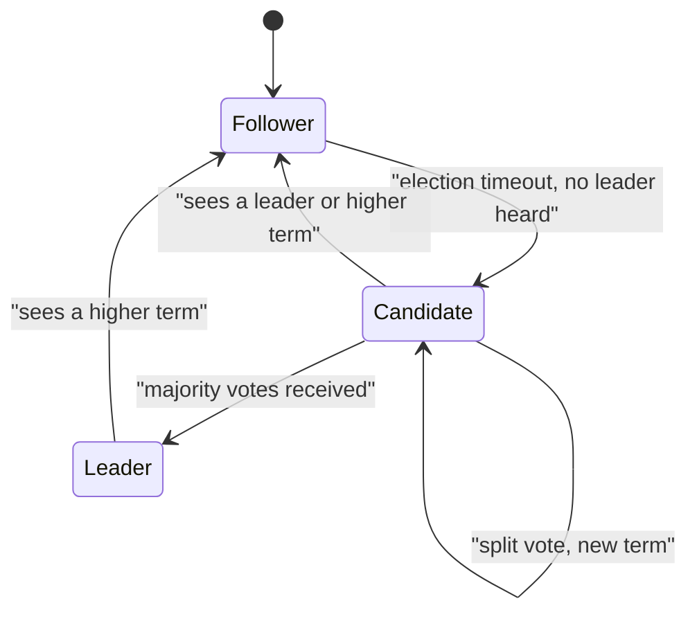

**In simple words:** Raft is a consensus algorithm that lets a group of servers keep **the same log of commands**, even if some servers crash. It was designed to be easier to understand than Paxos. One server is the **leader** and the others follow it. <Cite id="bft-paxos-raft-raft-paper" />

**Why it is needed:** in a distributed system every server must apply the same commands in the same order. Raft makes this safe when a minority of servers fail. It handles crash faults only, not lying (Byzantine) nodes. <Cite id="bft-paxos-raft-raft-site" />

**Roles.** Each server is in one of three states:
- **Follower:** passive, answers the leader and candidates.
- **Candidate:** a follower that wants to become leader.
- **Leader:** takes client requests, adds them to its log and copies them to followers.

Time is cut into **terms** (numbered 1, 2, 3...). Each term has at most one leader.

**How it works (three parts):**

1. **Leader election.** The leader sends regular heartbeats. If a follower hears none within a random timeout (150 to 300 ms in the paper), it becomes a candidate, adds 1 to the term, votes for itself and asks others for votes. A candidate with votes from a **majority** wins. Random timeouts make split votes rare. <Cite id="bft-paxos-raft-gfg-raft" />
2. **Log replication.** The client sends a command to the leader. The leader appends it to its log and sends it to followers (AppendEntries). When a majority has stored it, the entry is **committed**, the leader applies it and replies to the client. Followers apply it after learning it is committed.
3. **Safety.** A candidate can win only if its log is at least as up to date as the voters', so a committed entry is never lost.

**Example:** with 5 servers, a leader needs 3 copies to commit. The cluster keeps working with 2 servers down.

**Fault tolerance:** n = 2f + 1 servers tolerate f crashes.

**Advantages:** easy to understand, fast with one leader. **Limitations:** all writes pass through the leader; cannot tolerate malicious nodes. Used in permissioned blockchains such as Hyperledger Fabric's ordering service and Quorum. <Cite id="bft-paxos-raft-wiki-raft" />

**Conclusion:** Raft = elect a leader, replicate the log by majority, stay safe.
