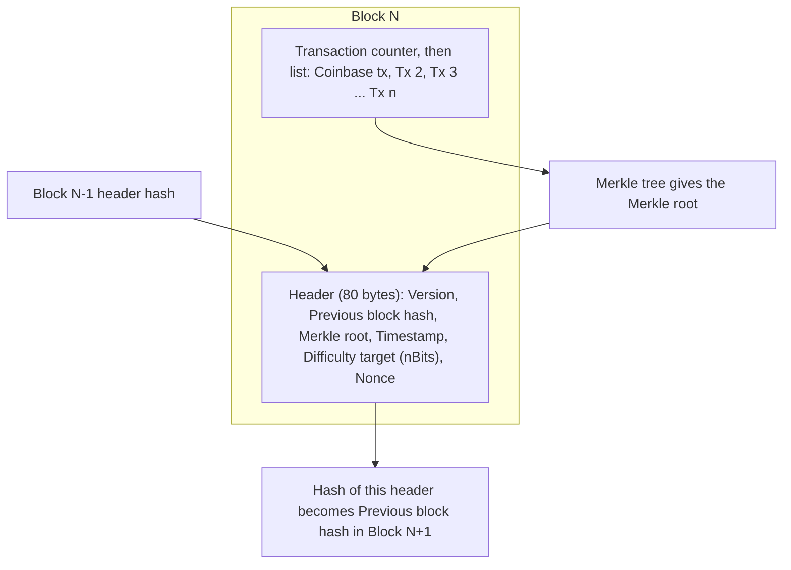

**In simple words:** a Bitcoin block is a package of transactions plus a small **header** that links it to the previous block. The header is what miners hash. <Cite id="block-structure-merkle-btcwiki-block" />

**Two main parts:**
1. **Block header** (80 bytes).
2. **Transaction list** (body), whose first transaction is the **coinbase** transaction that pays the miner the reward.

**Header fields:** <Cite id="block-structure-merkle-devref" />

| Field | Size | Meaning |
|---|---|---|
| Version | 4 bytes | Which validation rules apply |
| Previous block hash | 32 bytes | Hash of the last block's header; creates the chain |
| Merkle root | 32 bytes | Single hash summarising all transactions |
| Timestamp | 4 bytes | Approximate time the block was made |
| Difficulty target (nBits) | 4 bytes | The hash must be below this value |
| Nonce | 4 bytes | Number miners change to find a valid hash |

**Merkle root:** transactions are hashed in pairs, then the hashes are paired and hashed again, up to one root. Changing any transaction changes the root, and so the block hash. It also lets light clients prove a transaction is in a block with only a few hashes. <Cite id="block-structure-merkle-gfg-merkle-intro" />

**Block body:** the list of transactions, preceded by a counter. The coinbase transaction has no real input. Block size is limited (1 MB base, up to about 4 MB weight with SegWit) and about 2,000 to 3,000 transactions fit. <Cite id="block-structure-merkle-mb-ch11" />

**Block hash:** SHA-256 applied twice to the 80-byte header. It is not stored in the header; the next block carries it as "previous block hash".

**Why chained:** changing an old block changes its hash, which breaks the link in all later blocks, so tampering is easily detected.

**Example:** the first block (genesis, 2009) has a previous hash of all zeros.

**Conclusion:** the header links the blocks, the Merkle root protects the transactions and the nonce proves the work.
