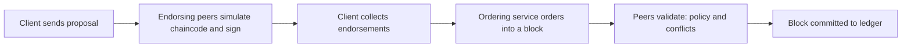

**In simple words:** Hyperledger Fabric businesses ke liye open-source **permissioned** blockchain platform hai, jo Linux Foundation host karta hai. Sirf jaane-pehchaane, approved members join karte hain, aur alag members kuch data private rakh sakte hain. <Cite id="hyperledger-fabric-whatis" />

**Ye kyun zaroori hai:** public blockchains open, slow hote hain aur sab kuch dikha dete hain. Companies ko identity, privacy, speed chahiye aur cryptocurrency nahi. Fabric ye deta hai. <Cite id="hyperledger-fabric-gfg-fabric" />

**Main components:**
- **Peers:** nodes jo ledger aur chaincode rakhte hain. *Endorsing peers* transactions chalate aur sign karte hain; *committing peers* blocks likhte hain.
- **Ordering service:** transactions ko blocks mein order karti hai (Raft recommended protocol hai) aur contracts nahi chalati. <Cite id="hyperledger-fabric-ordering" />
- **Membership Service Provider (MSP) aur CA:** certificates jo prove karte hain ki har member kaun hai.
- **Channels:** private sub-networks jinka apna ledger hota hai, taaki sirf chune hue members data dekhein. <Cite id="hyperledger-fabric-channels" />
- **Ledger:** blockchain (history) plus world state database (current values).
- **Chaincode:** Fabric ka smart contract, Go, Java ya JavaScript mein likha jaata hai.
- **Endorsement policy:** kaun se organizations ko sign karna hai, jaise "Org1 AND Org2".

**Transaction flow (execute-order-validate):** <Cite id="hyperledger-fabric-txflow" />

1. Client endorsing peers ko proposal bhejta hai.
2. Wo chaincode chalate hain, result (read-write set) banate hain aur sign karte hain.
3. Client endorsed transaction orderers ko bhejta hai.
4. Orderers transactions ko blocks mein sort karke peers ko bhejte hain.
5. Peers signatures aur conflicts check karte hain, phir commit karte hain.

**Features:** modular (consensus plug kar sakte hain), cryptocurrency zaroori nahi, private data collections, high throughput.

| Point | Fabric | Bitcoin or Ethereum |
|---|---|---|
| Access | Permissioned | Public |
| Consensus | Raft ordering | PoW or PoS |
| Privacy | Channels | None |
| Currency | Optional | Required |

**Use cases:** supply chain (IBM Food Trust), trade finance, healthcare records.

**Conclusion:** Fabric enterprises ko private, fast aur modular blockchain deta hai.
