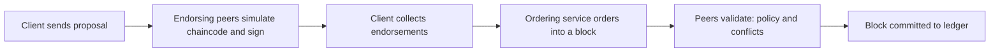

**In simple words:** Hyperledger Fabric is an open-source **permissioned** blockchain platform for businesses, hosted by the Linux Foundation. Only known, approved members join, and different members can keep some data private. <Cite id="hyperledger-fabric-whatis" />

**Why it is needed:** public blockchains are open, slow and show everything. Companies need identity, privacy, speed and no cryptocurrency. Fabric offers these. <Cite id="hyperledger-fabric-gfg-fabric" />

**Main components:**
- **Peers:** nodes that hold the ledger and chaincode. *Endorsing peers* run and sign transactions; *committing peers* write blocks.
- **Ordering service:** orders transactions into blocks (Raft is the recommended protocol) and does not run contracts. <Cite id="hyperledger-fabric-ordering" />
- **Membership Service Provider (MSP) and CA:** certificates that prove who each member is.
- **Channels:** private sub-networks with their own ledger, so only chosen members see the data. <Cite id="hyperledger-fabric-channels" />
- **Ledger:** a blockchain (history) plus a world state database (current values).
- **Chaincode:** Fabric's smart contract, written in Go, Java or JavaScript.
- **Endorsement policy:** which organizations must sign, e.g. "Org1 AND Org2".

**Transaction flow (execute-order-validate):** <Cite id="hyperledger-fabric-txflow" />

1. The client sends a proposal to endorsing peers.
2. They run the chaincode, produce a result (read-write set) and sign it.
3. The client sends the endorsed transaction to the orderers.
4. Orderers sort transactions into blocks and send them to peers.
5. Peers check signatures and conflicts, then commit.

**Features:** modular (plug in consensus), no cryptocurrency needed, private data collections, high throughput.

| Point | Fabric | Bitcoin or Ethereum |
|---|---|---|
| Access | Permissioned | Public |
| Consensus | Raft ordering | PoW or PoS |
| Privacy | Channels | None |
| Currency | Optional | Required |

**Use cases:** supply chain (IBM Food Trust), trade finance, healthcare records.

**Conclusion:** Fabric gives enterprises a private, fast and modular blockchain.
