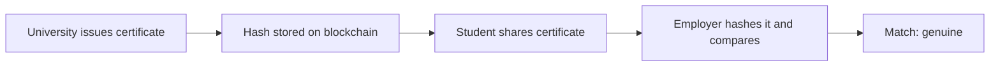

**In simple words:** education mein blockchain degrees aur certificates store kar sakta hai jinhe koi fake nahi kar sakta. Lekin asli colleges aur universities mein ise use karna mushkil hai. <Cite id="blockchain-applications-blockcerts" />

**Kahan use hota hai:** verifiable certificates (MIT Media Lab ka Blockcerts), student records, credit transfer, scholarship tracking. College har certificate ka hash blockchain pe rakhta hai; employer PDF ko dobara hash karke compare karta hai. <Cite id="blockchain-applications-gfg-industries" />

**Challenges:**

1. **Privacy aur law.** Blockchain edit nahi ho sakti, lekin privacy laws (jaise GDPR aur India ka DPDP Act) data sudharne ya mitaane ka haq dete hain. Student data openly store nahi karna chahiye; sirf hashes. <Cite id="blockchain-applications-tp-use-cases" />
2. **Cost aur technical skill.** Setup, nodes aur training schools ke liye mehenge hain, aur staff ko blockchain skills nahi hain.
3. **Purane systems ke saath integration.** Colleges existing ERP aur student information systems use karte hain jinhe jodna mushkil hai.
4. **Standards ki kami.** Alag institutes alag formats use karte hain, isliye certificates platforms ke beech readable nahi hote.
5. **Scalability.** Lakhon records aur public chains pe slow, mehengi writes.
6. **Galat data galat hi rehta hai.** Blockchain prove karti hai ki record badla nahi, ye nahi ki shuru mein sahi tha (garbage in, garbage out).
7. **Key loss.** Student private key kho de to credentials ka access chala sakta hai.
8. **Acceptance aur trust.** Employers, regulators aur universities sabko agree karna padega; awareness kam hai.
9. **Governance.** Nodes kaun chalayega, records kaun add karega, galtiyan kaun sudharega?
10. **Energy concerns** agar proof-of-work chain use ho.

| Challenge | Possible answer |
|---|---|
| Privacy | Sirf hashes store karo, data off-chain rakho |
| Cost | Shared consortium network |
| Standards | Common credential formats (jaise Open Badges) |
| Mistakes | Revocation record issue karo |

**Conclusion:** blockchain fake degrees kam kar sakti hai, lekin pehle cost, privacy law, standards aur adoption solve karne honge. <Cite id="blockchain-fundamentals-gfg-advantages" />
