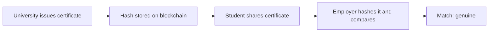

**In simple words:** in education, blockchain can store degrees and certificates that nobody can fake. But using it in real colleges and universities is hard. <Cite id="blockchain-applications-blockcerts" />

**Where it is used:** verifiable certificates (MIT Media Lab's Blockcerts), student records, credit transfer, scholarship tracking. A college stores the hash of each certificate on the blockchain; an employer re-hashes the PDF and compares. <Cite id="blockchain-applications-gfg-industries" />

**Challenges:**

1. **Privacy and law.** A blockchain cannot be edited, but privacy laws (such as GDPR and India's DPDP Act) give the right to correct or erase data. Student data must not be stored openly; only hashes should be. <Cite id="blockchain-applications-tp-use-cases" />
2. **Cost and technical skill.** Setup, nodes and training are costly for schools, and staff lack blockchain skills.
3. **Integration with old systems.** Colleges use existing ERP and student information systems that are hard to connect.
4. **Lack of standards.** Different institutes use different formats, so certificates are not readable across platforms.
5. **Scalability.** Millions of records and slow, costly writes on public chains.
6. **Wrong data stays wrong.** Blockchain proves a record was not changed, not that it was correct at the start (garbage in, garbage out).
7. **Key loss.** If a student loses the private key, access to credentials may be lost.
8. **Acceptance and trust.** Employers, regulators and universities must all agree to use it; awareness is low.
9. **Governance.** Who runs the nodes, who can add records, who fixes mistakes?
10. **Energy concerns** if a proof-of-work chain is used.

| Challenge | Possible answer |
|---|---|
| Privacy | Store only hashes, keep data off-chain |
| Cost | Shared consortium network |
| Standards | Common credential formats (such as Open Badges) |
| Mistakes | Issue a revocation record |

**Conclusion:** blockchain can reduce fake degrees, but cost, privacy law, standards and adoption must be solved first. <Cite id="blockchain-fundamentals-gfg-advantages" />
