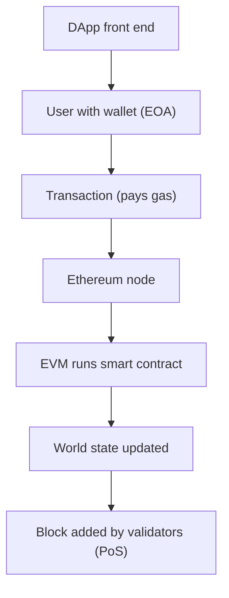

**In simple words:** Ethereum ek blockchain hai jo programs (smart contracts) chalati hai, sirf payments nahi. Ise ek worldwide shared computer samjho. Iske kai parts hain jo saath kaam karte hain. <Cite id="ethereum-me-ch1" />

**Components:**

1. **Ethereum accounts.** Do kism ke: *Externally Owned Accounts (EOA)*, jo private key se control hote hain, aur *contract accounts*, jo code se control hote hain. Har ek ka address, balance aur nonce hota hai. <Cite id="ethereum-eth-accounts" />
2. **Ether (ETH).** Native currency, fees dene ke liye aur proof of stake mein stake ke roop mein use hoti hai.
3. **Transactions.** EOA ke signed messages jo ETH bhejte hain ya contract call karte hain. Ye state badalte hain.
4. **Smart contracts.** Blockchain pe stored programs, Solidity mein likhe, jo bilkul code ke hisaab se chalte hain.
5. **Ethereum Virtual Machine (EVM).** Engine jo har node pe contract bytecode chalata hai, taaki sabko same result mile. <Cite id="ethereum-eth-evm" />
6. **Gas.** Computation ki fee ki unit. Fee = gas used x gas price. Ye validators ko pay karti hai aur endless loops rokti hai. <Cite id="ethereum-eth-gas" />
7. **Nodes aur clients.** Computers jo Ethereum software (jaise Geth) chalate hain aur chain rakhte hain.
8. **Consensus layer.** Proof of stake: validators jo 32 ETH lock karte hain blocks propose aur attest karte hain.
9. **World state aur blocks.** State mein saare balances aur contract storage hai; blocks transactions bundle karte hain jo ise badalte hain.
10. **Networks.** Mainnet (asli paisa) aur testnets (free test ETH).
11. **Tools aur DApps.** Remix, Hardhat, Ganache, MetaMask wallet, Web3 libraries, aur contracts pe bane decentralized apps. <Cite id="ethereum-gfg-components" />

**Example:** Asha token contract ko transaction bhejti hai. EVM uska `transfer` function chalata hai, state mein balances badalte hain, aur wo ETH mein gas pay karti hai.

**Conclusion:** accounts, EVM, gas, contracts aur consensus milkar Ethereum ko programmable blockchain banate hain. <Cite id="ethereum-eth-stack" />
