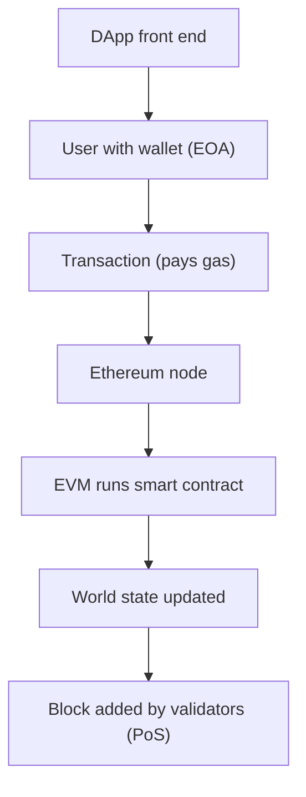

**In simple words:** Ethereum is a blockchain that runs programs (smart contracts), not just payments. Think of it as one worldwide shared computer. It has several parts that work together. <Cite id="ethereum-me-ch1" />

**Components:**

1. **Ethereum accounts.** Two kinds: *Externally Owned Accounts (EOA)*, controlled by a private key, and *contract accounts*, controlled by code. Each has an address, a balance and a nonce. <Cite id="ethereum-eth-accounts" />
2. **Ether (ETH).** The native currency, used to pay fees and as the stake in proof of stake.
3. **Transactions.** Signed messages from an EOA that send ETH or call a contract. They change the state.
4. **Smart contracts.** Programs stored on the blockchain, written in Solidity, that run exactly as coded.
5. **Ethereum Virtual Machine (EVM).** The engine that runs contract bytecode on every node, so all get the same result. <Cite id="ethereum-eth-evm" />
6. **Gas.** The fee unit for computation. Fee = gas used x gas price. It pays validators and stops endless loops. <Cite id="ethereum-eth-gas" />
7. **Nodes and clients.** Computers that run Ethereum software (such as Geth) and keep the chain.
8. **Consensus layer.** Proof of stake: validators who lock 32 ETH propose and attest blocks.
9. **World state and blocks.** The state holds all balances and contract storage; blocks bundle transactions that change it.
10. **Networks.** Mainnet (real money) and testnets (free test ETH).
11. **Tools and DApps.** Remix, Hardhat, Ganache, MetaMask wallet, Web3 libraries, and decentralized apps built on contracts. <Cite id="ethereum-gfg-components" />

**Example:** Asha sends a transaction to a token contract. The EVM runs its `transfer` function, balances change in the state, and she pays gas in ETH.

**Conclusion:** accounts, EVM, gas, contracts and consensus together make Ethereum a programmable blockchain. <Cite id="ethereum-eth-stack" />
