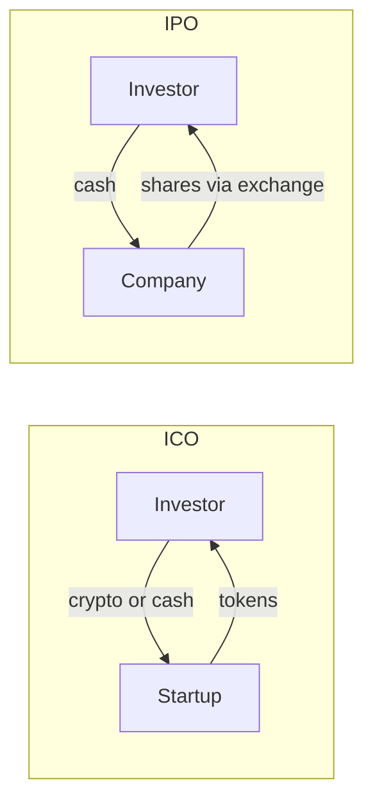

**In simple words:** ICO aur IPO dono tareeke hain jisse company **public se paisa jutati hai**. **ICO (Initial Coin Offering)** mein investors ko naye digital tokens milte hain. **IPO (Initial Public Offering)** mein unhe shares milte hain, yaani company ki partial ownership. <Cite id="cryptocurrencies-tokens-gfg-ico" />

**Har ek kaise kaam karta hai:**
- ICO: startup whitepaper publish karta hai, smart contract se tokens banata hai, aur Bitcoin, Ether ya paise ke badle bechta hai. <Cite id="cryptocurrencies-tokens-wiki-ico" />
- IPO: company investment bankers hire karti hai, regulator (India mein SEBI) ke paas prospectus file karti hai, aur stock exchange pe shares list karti hai. <Cite id="cryptocurrencies-tokens-wiki-ipo" />

**ICO pros:**
- Duniya mein koi bhi invest kar sakta hai, chhoti amounts bhi.
- Fast aur sasta, banks ya exchange ke bina.
- Tokens aksar turant trade ho sakte hain.
- Startups ko ownership nahi chhodni padti.

**ICO cons:**
- Zyada tar unregulated, isliye bahut scams aur failed projects.
- Tokens company pe koi haq nahi dete.
- Price mein bahut utaar-chadhaav.
- Investor protection kamzor aur disclosure kam.

**IPO pros:**
- Strong regulation aur disclosure, isliye zyada trust.
- Shares ownership, votes aur dividends dete hain.
- Badi amounts jutayi ja sakti hain aur company ka status badhta hai.
- Shares regulated exchange pe trade hote hain.

**IPO cons:**
- Mehenga (bankers, audit, legal) aur slow, aksar mahine.
- Sirf mature companies qualify karti hain.
- Listing ke baad reporting ke bhaari rules.
- Founders kuch control kho dete hain.

| Point | ICO | IPO |
|---|---|---|
| Offered | Tokens | Shares |
| Regulation | Light or none | Strict |
| Cost and time | Low, quick | High, slow |
| Who invests | Anyone online | Regulated market investors |
| Rights | Usually few | Ownership, votes, dividends |
| Risk | Very high | Moderate |

**Conclusion:** ICO open aur fast hai lekin risky; IPO safer aur regulated hai lekin mehenga. Ab kai desh token sales ko securities offerings ki tarah regulate karte hain.
