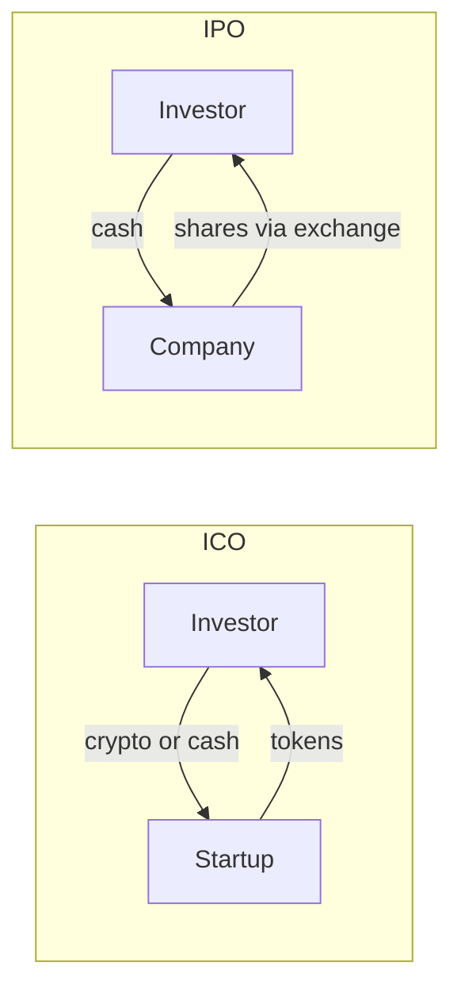

**In simple words:** both ICO and IPO are ways for a company to **raise money from the public**. In an **ICO (Initial Coin Offering)** investors get new digital tokens. In an **IPO (Initial Public Offering)** they get shares, i.e. part ownership of the company. <Cite id="cryptocurrencies-tokens-gfg-ico" />

**How each works:**
- ICO: a startup publishes a whitepaper, creates tokens with a smart contract, and sells them for Bitcoin, Ether or money. <Cite id="cryptocurrencies-tokens-wiki-ico" />
- IPO: a company hires investment bankers, files a prospectus with the regulator (SEBI in India), and lists shares on a stock exchange. <Cite id="cryptocurrencies-tokens-wiki-ipo" />

**ICO pros:**
- Anyone in the world can invest, small amounts too.
- Fast and cheap, with no banks or exchange.
- Tokens can often be traded straight away.
- Startups need not give up ownership.

**ICO cons:**
- Mostly unregulated, so many scams and failed projects.
- Tokens may give no rights over the company.
- Price swings are very high.
- Weak investor protection and little disclosure.

**IPO pros:**
- Strong regulation and disclosure, so more trust.
- Shares give ownership, votes and dividends.
- Large amounts can be raised and the company gains status.
- Shares trade on a regulated exchange.

**IPO cons:**
- Expensive (bankers, audit, legal) and slow, often months.
- Only mature companies qualify.
- Heavy rules on reporting after listing.
- The founders lose some control.

| Point | ICO | IPO |
|---|---|---|
| Offered | Tokens | Shares |
| Regulation | Light or none | Strict |
| Cost and time | Low, quick | High, slow |
| Who invests | Anyone online | Regulated market investors |
| Rights | Usually few | Ownership, votes, dividends |
| Risk | Very high | Moderate |

**Conclusion:** ICOs are open and fast but risky; IPOs are safer and regulated but costly. Many countries now regulate token sales as securities offerings.
