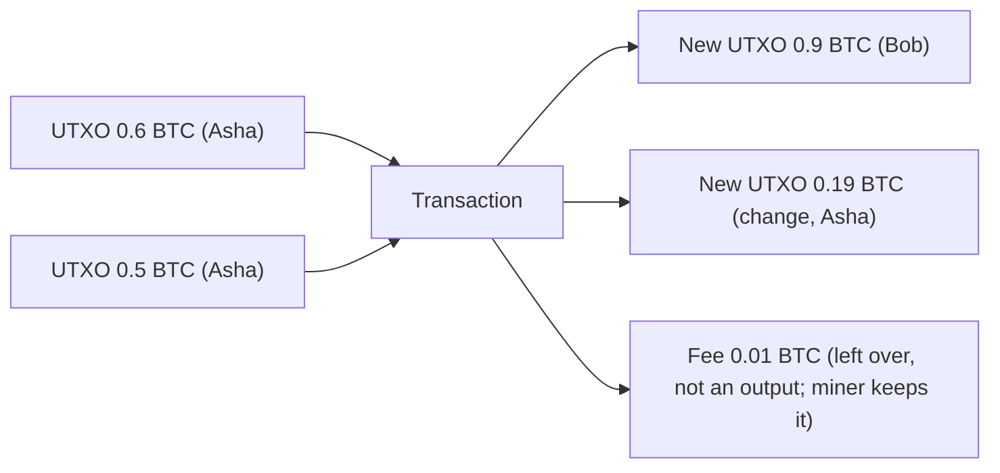

**In simple words:** Bitcoin account balances nahi rakhta. Wo **Unspent Transaction Outputs (UTXOs)** ki list rakhta hai, jo na kharch kiye hue cash notes jaisi hain. Aapka "balance" un UTXOs ka total hai jinhe aapki keys unlock kar sakti hain. <Cite id="wallets-utxo-double-spending-learnmeabitcoin-utxo" />

**Ye kaise kaam karta hai:**
1. Har transaction mein **inputs** (jo UTXOs kharch ho rahe hain) aur **outputs** (naye UTXOs jo ban rahe hain) hote hain.
2. Input ko poora UTXO kharch karna padta hai; use todha nahi ja sakta. Isliye bacha hua hissa aapko hi **change** ke roop mein wapas bhejte hain.
3. Total inputs, total outputs se kam nahi ho sakte. Jo fark hai woh miner ki **fee** hai.
4. Ek baar kharch hua UTXO khatam. Saare unspent outputs ka set UTXO set hai jo har full node rakhta hai. <Cite id="bitcoin-mb-ch06-transactions" />

<Sum>

<Given>

Asha ke paas do UTXOs hain: 0.6 BTC aur 0.5 BTC. Wo Bob ko 0.9 BTC deti hai aur 0.01 BTC fee accept karti hai.

</Given>

<Find>

change output, aur kya transaction balance hoti hai.

</Find>

<Steps>

1. Total inputs: $0.6 + 0.5 = 1.1$ BTC. *Reason: ek UTXO (0.6), 0.9 ke liye kaafi nahi, isliye dono kharch hote hain.*
2. Payment aur fee ke roop mein jaane wala paisa: $0.9 + 0.01 = 0.91$ BTC.
3. Asha ko wapas change: $1.1 - 0.91 = 0.19$ BTC. *Reason: inputs poore use hone chahiye.*

</Steps>

<Answer>

Outputs: Bob ko 0.9 BTC, Asha ko 0.19 BTC change; fee 0.01 BTC.

</Answer>

<Box kind="verify">

Inputs $1.1$ = outputs $(0.9 + 0.19 = 1.09)$ + fee $0.01$ = $1.10$. Balance ho gaya. Fee output nahi hai; wo bas bacha hua hissa hai.

</Box>

</Sum>

**Advantages:** verify karna aasan, double spending nahi (UTXO sirf ek baar kharch hota hai), parallel checking, naye addresses se better privacy. **Disadvantages:** balances ke mukable program karna mushkil, bahut saare chhote UTXOs se badi transactions, change ka dhyan rakhna padta hai.

**Ethereum se comparison:** Ethereum account model use karta hai (har account ka balance). <Cite id="wallets-utxo-double-spending-gfg-utxo" />

**Conclusion:** Bitcoin coins ko spendable outputs ki tarah track karta hai jo har baar consume hote aur dobara bante hain. <Cite id="wallets-utxo-double-spending-wiki-utxo" />
