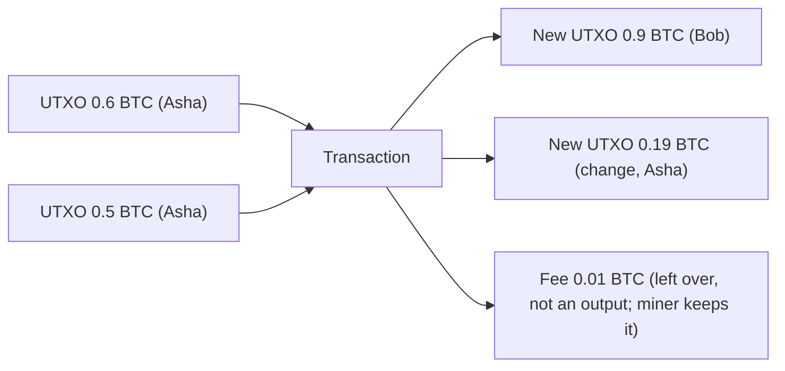

**In simple words:** Bitcoin does not keep account balances. It keeps a list of **Unspent Transaction Outputs (UTXOs)**, which are like unspent cash notes. Your "balance" is the total of the UTXOs your keys can unlock. <Cite id="wallets-utxo-double-spending-learnmeabitcoin-utxo" />

**How it works:**
1. Every transaction has **inputs** (UTXOs being spent) and **outputs** (new UTXOs created).
2. An input must spend a whole UTXO; it cannot be split. So the extra is sent back to yourself as **change**.
3. Total inputs must be at least total outputs. The difference is the **fee** for the miner.
4. Once spent, a UTXO is gone. The set of all unspent outputs is the UTXO set that every full node keeps. <Cite id="bitcoin-mb-ch06-transactions" />

<Sum>

<Given>

Asha owns two UTXOs: 0.6 BTC and 0.5 BTC. She pays Bob 0.9 BTC and accepts a fee of 0.01 BTC.

</Given>

<Find>

the change output, and whether the transaction balances.

</Find>

<Steps>

1. Total inputs: $0.6 + 0.5 = 1.1$ BTC. *Reason: one UTXO (0.6) is not enough for 0.9, so both are spent.*
2. Money leaving as payment and fee: $0.9 + 0.01 = 0.91$ BTC.
3. Change back to Asha: $1.1 - 0.91 = 0.19$ BTC. *Reason: inputs must be fully used.*

</Steps>

<Answer>

Outputs: 0.9 BTC to Bob, 0.19 BTC change to Asha; fee 0.01 BTC.

</Answer>

<Box kind="verify">

Inputs $1.1$ = outputs $(0.9 + 0.19 = 1.09)$ + fee $0.01$ = $1.10$. It balances. The fee is not an output; it is just the left-over.

</Box>

</Sum>

**Advantages:** easy to verify, no double spending (a UTXO can be spent once), parallel checking, better privacy with new addresses. **Disadvantages:** harder to program than balances, many small UTXOs make big transactions, change needs care.

**Compared with Ethereum:** Ethereum uses an account model (a balance per account). <Cite id="wallets-utxo-double-spending-gfg-utxo" />

**Conclusion:** Bitcoin tracks coins as spendable outputs that are consumed and recreated each time. <Cite id="wallets-utxo-double-spending-wiki-utxo" />
