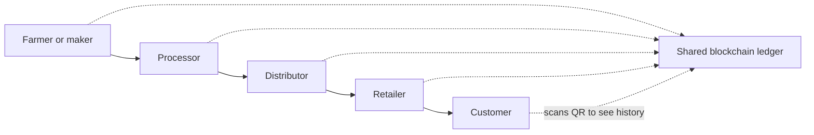

**In simple words:** supply chain kisi product ka khet ya factory se dukaan tak ka safar hai. Blockchain har step ka ek shared, na badalne wala record rakhti hai, taaki sab bharosa kar sakein ki product kahan se aaya. <Cite id="blockchain-applications-gfg-supply-revolution" />

**Traditional supply chains ki problems:** records paper pe ya alag company databases mein hote hain; visibility kam; fakes aur fraud; slow paperwork; recalls mein der kyunki source dhoondhna mushkil.

**Blockchain kaise madad karti hai:**
1. Har step (harvest, packing, shipping, storage, sale) us party ki transaction ke roop mein record hota hai jisne kiya.
2. Sensors (IoT, RFID, QR codes) temperature aur location jaisa data add kar sakte hain.
3. Saare partners same ledger dekhte hain; purani entries koi badal nahi sakta.
4. **Smart contracts** delivery par payment automatically release kar sakte hain.

**Benefits:** traceability, kam fakes, fast recall, kam paperwork, tez payments, partners ke beech trust. <Cite id="blockchain-applications-wiki-supply" />

**Challenges:** cost aur integration, saare partners ko join karna padega, shuru mein galat data daala to galat hi rahega, business data ki privacy, aur standards.

**Real examples:**
- **IBM Food Trust (Hyperledger Fabric):** Walmart ne mango ki origin trace karna days se lagbhag 2.2 seconds mein kar liya. <Cite id="blockchain-applications-gfg-industries" />
- **Maersk aur IBM TradeLens:** shipping documents (2023 ki shuruaat tak band ho gaya).
- **De Beers Tracr:** diamonds ki tracking.

**Conclusion:** blockchain supply chains mein visibility aur trust lati hai.
