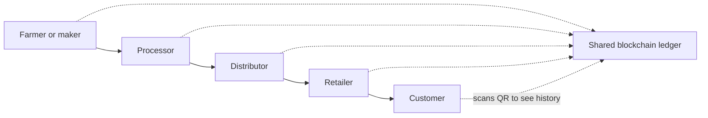

**In simple words:** a supply chain is the journey of a product from the farm or factory to the shop. Blockchain keeps one shared, unchangeable record of every step, so everyone can trust where a product came from. <Cite id="blockchain-applications-gfg-supply-revolution" />

**Problems in traditional supply chains:** records are on paper or in separate company databases; there is little visibility; fakes and fraud; slow paperwork; recalls take long because it is hard to find the source.

**How blockchain helps:**
1. Each step (harvest, packing, shipping, storage, sale) is recorded as a transaction by the party who did it.
2. Sensors (IoT, RFID, QR codes) can add data such as temperature and location.
3. All partners see the same ledger; no one can change old entries.
4. **Smart contracts** can release payment automatically on delivery.

**Benefits:** traceability, fewer fakes, fast recall, less paperwork, faster payments, trust between partners. <Cite id="blockchain-applications-wiki-supply" />

**Challenges:** cost and integration, all partners must join, wrong data entered at the start stays wrong, privacy of business data, and standards.

**Real examples:**
- **IBM Food Trust (Hyperledger Fabric):** Walmart traced mango origin from days to about 2.2 seconds. <Cite id="blockchain-applications-gfg-industries" />
- **Maersk and IBM TradeLens:** shipping documents (wound down by early 2023).
- **De Beers Tracr:** tracking diamonds.

**Conclusion:** blockchain brings visibility and trust to supply chains.
