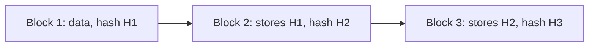

**In simple words:** a blockchain is a shared notebook of records. Many computers keep the same copy, and old pages cannot be changed easily.

**Definition:** a blockchain is a shared, tamper-proof digital ledger that securely stores data across a decentralized network of computers. Instead of a central authority like a bank, participants use cryptography and consensus to verify and record transactions in chronological blocks that are permanently linked together. <Cite id="class-bt-m1" loc="slide 10" /> <Cite id="blockchain-fundamentals-ibm-blockchain" />

**Key characteristics:**

1. **Decentralization.** No central authority controls the data; the participants maintain it and approve transactions. <Cite id="class-bt-m1" loc="slide 19" /> **Example:** Bitcoin has no owner.
2. **Distributed ledger.** Every participant holds the same copy, so one corrupted copy is noticed and fixed by the others. <Cite id="class-bt-m1" loc="slide 20" />
3. **Immutability.** The ledger is append-only; each block stores the hash of the previous block, so changing an old block breaks all later blocks. <Cite id="class-bt-m1" loc="slide 105" />
4. **Transparency.** All permitted participants can see the same records, in time order.
5. **Security.** Hashing keeps data intact; digital signatures prove who sent a transaction. <Cite id="class-bt-m1" loc="slide 11" />
6. **Consensus.** Nodes follow a rule such as Proof of Work to agree on the next block.
7. **Peer-to-peer, no trusted third party.** Value moves directly between users. <Cite id="class-bt-m1" loc="slide 20" />

| Characteristic | What it gives |
|---|---|
| Decentralized | No single point of failure or control |
| Immutable | Trustworthy history |
| Transparent | Easy audit |
| Secure | Protection from fraud and tampering |

**Extend in the exam (add these to reach 10 marks):**

- **Block parts.** Header (previous hash, Merkle root, timestamp, nonce) and body (transactions). <Cite id="class-bt-m1" loc="slide 69" />
- **Why needed.** Data kept in one place can be hacked or fail; storing it on many computers solves this. <Cite id="class-bt-m1" loc="slide 4" />
- **Types.** Public, private, consortium and hybrid. <Cite id="class-bt-m1" loc="slide 43" />
- **Diagram.** Draw the chain with the previous-hash arrows (above).
- **Limits.** Slow, uses energy (Proof of Work) and cannot easily fix mistakes.

**Conclusion:** a blockchain is a decentralized, immutable, transparent and secure shared ledger.
