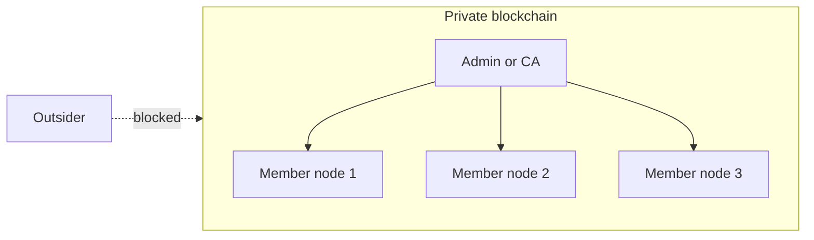

**In simple words:** a private blockchain is a members-only blockchain. Companies use it when they want blockchain benefits but cannot show their data to everyone.

**Definition:** a private (permissioned) blockchain is owned by one organisation that decides who may read, write and validate, and only authorised users take part, in a closed network. <Cite id="class-bt-m1" loc="slide 58" />

**Need for private blockchains:**

1. **Privacy of business data.** On a public chain everyone sees every transaction; a company cannot show prices, contracts or customers to rivals. <Cite id="class-bt-m1" loc="slide 59" />
2. **Known identities.** Rules such as KYC and audit need to know who takes part, which the permissioned design gives. <Cite id="class-bt-m1" loc="slide 49" />
3. **Speed and scalability.** Few trusted nodes verify, so transactions are fast and the network size can be set by the owner. <Cite id="class-bt-m1" loc="slide 59" />
4. **Control and governance.** The owner can set rules, add or remove members and fix errors. <Cite id="class-bt-m4" loc="slide 3" />
5. **Low cost and energy.** No mining; consensus by voting (Raft, PBFT, PoA).
6. **Trust problem of public chains.** Open chains are slow and energy hungry. <Cite id="class-bt-m1" loc="slide 56" />

| Point | Public | Private |
|---|---|---|
| Who joins | Anyone | Invited members |
| Speed | Slow | Fast |
| Privacy | Low | High |
| Consensus | PoW, PoS | Raft, PBFT, PoA |
| Control | Nobody | Owner or group |

<Cite id="private-blockchain-gfg-pubpriv" />

**Extend in the exam (add these to reach 10 marks):**

- **Uses.** Internal auditing, voting and asset management; example Hyperledger. <Cite id="class-bt-m1" loc="slide 61" />
- **Characteristics.** Permissioned access, centralised governance, privacy, rules can change. <Cite id="class-bt-m4" loc="slide 3" />
- **Limits.** Less decentralised, fewer nodes so more chance of manipulation, and trust sits with the owner. <Cite id="class-bt-m1" loc="slide 60" />
- **Platforms.** Hyperledger Fabric, Corda, Quorum. <Cite id="private-blockchain-fabric-whatis" />

**Conclusion:** private blockchains give shared-ledger benefits with the privacy, speed and control that businesses need.
